+++
title = "ORA: Open Robot-Use Agents"
date = 2026-10-15T12:00:00-07:00
url = "/blogs/ora/"
description = "An open robot-use harness that connects open-weight language models to robots."
authors = ["Yuanbo Yang", "Siyi Chen", "Jun Gao", "Hao Zhang"]
author = "ORA Team"
math = false
ShowReadingTime = false
ShowToc = true
TocOpen = false
draft = false
summary = "ORA is an open robot-use agent harness that lets open-weight language models operate robots zero-shot, with no VLA, no robot training and no task-specific memory. On RoboTwin and LIBERO-Pro it passes the official success check in 69.2% and 81.4% of cases."
[cover]
    image = "img/cover.jpg"
    relative = true
    alt = "ORA at work on a RoboDojo task: the agent terminal beside the robot cameras"
    hidden = true
[socialIcons]
    [[socialIcons.icon]]
      name = "twitter"
      url = "https://twitter.com/haoailab"
    [[socialIcons.icon]]
      name = "github"
      url = "https://github.com/hao-ai-lab/ORA"
+++

<!-- Generated by page/export_hugo.py from the blog source (github.com/freemty/robot-harness, branch blog). -->
<link rel="stylesheet" href="ora.css">

<a class="btn" href="https://github.com/hao-ai-lab/ORA"><svg aria-hidden="true" viewbox="0 0 16 16"><path d="M8 0C3.58 0 0 3.58 0 8c0 3.54 2.29 6.53 5.47 7.59.4.07.55-.17.55-.38 0-.19-.01-.82-.01-1.49-2.01.37-2.53-.49-2.69-.94-.09-.23-.48-.94-.82-1.13-.28-.15-.68-.52-.01-.53.63-.01 1.08.58 1.23.82.72 1.21 1.87.87 2.33.66.07-.52.28-.87.51-1.07-1.78-.2-3.64-.89-3.64-3.95 0-.87.31-1.59.82-2.15-.08-.2-.36-1.02.08-2.12 0 0 .67-.21 2.2.82.64-.18 1.32-.27 2-.27.68 0 1.36.09 2 .27 1.53-1.04 2.2-.82 2.2-.82.44 1.1.16 1.92.08 2.12.51.56.82 1.27.82 2.15 0 3.07-1.87 3.75-3.65 3.95.29.25.54.73.54 1.48 0 1.07-.01 1.93-.01 2.2 0 .21.15.46.55.38A8.013 8.013 0 0016 8c0-4.42-3.58-8-8-8z"></path></svg>Code</a><a class="btn" href="https://freemty.github.io/ora/appendix/">Appendix</a><a class="btn" href="https://freemty.github.io/ora/gallery/">Gallery · 153 episodes</a>

<b>TL;DR: </b>ORA is an open robot-use agent harness that lets open-weight language models operate robots <b>fully zero-shot: no VLA, no robot training and no task-specific memory</b>, with results on RoboTwin and LIBERO-Pro (69.2% and 81.4% by the official success checks) competitive with agents built on frontier models. It gets there with a harness designed for robot tasks in the physical world: exact task and environment context, tools for perception and motion, and context management.

<figure class="ora-hero" id="fig-hero"><video autoplay muted loop playsinline controls preload="metadata" poster="img/i-aa2245c958ee.jpg" aria-label="ORA overview video"><source src="img/videos/ora-teaser.mp4" type="video/mp4"></video><figcaption class="figcap"><b class="fl">Figure 1.</b> DeepSeek-V4.1-Flash, an open-weight model, operating robots through ORA, zero-shot. Estimated model-token cost at DeepSeek's off-peak API rates, using estimated cache hits: $0.13 per solved task on average across the 40 shown here, or $0.30–$0.35 per solved benchmark case including failed attempts. These are API-equivalent estimates, not actual self-hosting costs; GPU and simulator costs are excluded (see <a href="#cost">Cost</a>).</figcaption></figure>

<figure class="bench" id="bench-robotwin" style="--bar-count:6">

(a) RoboTwin C2R
50 tasks · 250 cases

Success (%)

0255075100
<ol class="bars"><li aria-label="ORA + DeepSeek-V4.1-Flash: 69.2%. our harness + open-weight model · no VLA, robot training or task memory. 173/250 cases succeed; 0 without a valid outcome count as failures." class="b-ours" data-rate="69.2" tabindex="0"><i style="height:69.2000%">69.2</i>ORADeepSeek<b>ORA + DeepSeek-V4.1-Flash · 69.2%</b>our harness + open-weight model · no VLA, robot training or task memory173/250 cases succeed; 0 without a valid outcome count as failures.</li><li aria-label="RPent + GPT-5.5: 62.4%. RPent harness + language model + VLA + task-specific memory. As published by RPent; 156/250 reported outcomes." class="b-rpent" data-rate="62.4" tabindex="0"><i style="height:62.4000%">62.4</i>GPT-5.5RPent<b>RPent + GPT-5.5 · 62.4%</b>RPent harness + language model + VLA + task-specific memoryAs published by RPent; 156/250 reported outcomes.</li><li aria-label="RPent + Opus-4.7: 58.4%. RPent harness + language model + VLA + task-specific memory. As published by RPent; 250 reported cases." class="b-rpent" data-rate="58.4" tabindex="0"><i style="height:58.4000%">58.4</i>Opus-4.7RPent<b>RPent + Opus-4.7 · 58.4%</b>RPent harness + language model + VLA + task-specific memoryAs published by RPent; 250 reported cases.</li><li aria-label="LingBot-VLA: 50.4%. VLA, trained on robot demos. As published by RPent; count not reported." class="b-ref" data-rate="50.4" tabindex="0"><i style="height:50.4000%">50.4</i>LingBotVLA<b>LingBot-VLA · 50.4%</b>VLA, trained on robot demosAs published by RPent; count not reported.</li><li aria-label="π0.5: 47.9%. VLA, trained on robot demos. As published by RPent; count not reported." class="b-ref" data-rate="47.9" tabindex="0"><i style="height:47.9000%">47.9</i>π0.5<b>π0.5 · 47.9%</b>VLA, trained on robot demosAs published by RPent; count not reported.</li><li aria-label="GR00T-N1.7: 20.7%. VLA, trained on robot demos. As published by RPent; count not reported." class="b-ref" data-rate="20.7" tabindex="0"><i style="height:20.7000%">20.7</i>GR00TN1.7<b>GR00T-N1.7 · 20.7%</b>VLA, trained on robot demosAs published by RPent; count not reported.</li></ol>

</figure><figure class="bench" id="bench-libero-pro" style="--bar-count:9">

(b) LIBERO-Pro
8 Task and Swap suites · 800 cases

Success (%)

0255075100
<ol class="bars"><li aria-label="ORA + DeepSeek-V4.1-Flash: 81.4%. our harness + open-weight model · no VLA, robot training or task memory. 651/800 cases succeed; 0 without a valid outcome count as failures." class="b-ours" data-rate="81.375" tabindex="0"><i style="height:81.3750%">81.4</i>ORADeepSeek<b>ORA + DeepSeek-V4.1-Flash · 81.4%</b>our harness + open-weight model · no VLA, robot training or task memory651/800 cases succeed; 0 without a valid outcome count as failures.</li><li aria-label="RPent + GPT-6 Astra [a]: 92.63%. RPent harness + language model + VLA + task-specific memory. As published by RPent; 741/800 reported outcomes." class="b-rpent" data-rate="92.63" tabindex="0"><i style="height:92.6300%">92.63</i>AstraRPent [a]<b>RPent + GPT-6 Astra [a] · 92.63%</b>RPent harness + language model + VLA + task-specific memoryAs published by RPent; 741/800 reported outcomes.</li><li aria-label="RPent + Opus-4.7: 82.4%. RPent harness + language model + VLA + task-specific memory. As published by RPent; 800 reported cases." class="b-rpent" data-rate="82.4" tabindex="0"><i style="height:82.4000%">82.4</i>Opus-4.7RPent<b>RPent + Opus-4.7 · 82.4%</b>RPent harness + language model + VLA + task-specific memoryAs published by RPent; 800 reported cases.</li><li aria-label="RPent + GPT-5.5: 75.13%. RPent harness + language model + VLA + task-specific memory. As published by RPent; 800 reported cases." class="b-rpent" data-rate="75.13" tabindex="0"><i style="height:75.1300%">75.13</i>GPT-5.5RPent<b>RPent + GPT-5.5 · 75.13%</b>RPent harness + language model + VLA + task-specific memoryAs published by RPent; 800 reported cases.</li><li aria-label="RPent Flash Mode [b]: 72.63%. RPent harness + Molmo2-8B + VLA + released task-specific memory. As published by RPent; 581/800 reported outcomes." class="b-rpent" data-rate="72.63" tabindex="0"><i style="height:72.6300%">72.63</i>FlashRPent [b]<b>RPent Flash Mode [b] · 72.63%</b>RPent harness + Molmo2-8B + VLA + released task-specific memoryAs published by RPent; 581/800 reported outcomes.</li><li aria-label="RPent + Qwen3.6 27B: 70.63%. RPent harness + open-weight model + VLA + task-specific memory. As published by RPent; 565/800 reported outcomes." class="b-rpent" data-rate="70.63" tabindex="0"><i style="height:70.6300%">70.63</i>QwenRPent<b>RPent + Qwen3.6 27B · 70.63%</b>RPent harness + open-weight model + VLA + task-specific memoryAs published by RPent; 565/800 reported outcomes.</li><li aria-label="π_RLinf: 50.0%. VLA, robot demos + RL. As published by RPent; count not reported." class="b-ref" data-rate="50.0" tabindex="0"><i style="height:50.0000%">50.0</i>πRLinf<b>π_RLinf · 50.0%</b>VLA, robot demos + RLAs published by RPent; count not reported.</li><li aria-label="π0.5: 11.0%. VLA, trained on robot demos. As published by RPent; count not reported." class="b-ref" data-rate="11.0" tabindex="0"><i style="height:11.0000%">11.0</i>π0.5<b>π0.5 · 11.0%</b>VLA, trained on robot demosAs published by RPent; count not reported.</li><li aria-label="AtomVLA: 6.3%. VLA, trained on robot demos. As published by RPent; count not reported." class="b-ref" data-rate="6.3" tabindex="0"><i style="height:6.3000%">6.3</i>AtomVLA<b>AtomVLA · 6.3%</b>VLA, trained on robot demosAs published by RPent; count not reported.</li></ol>

</figure>

<i class="k-ours"></i>ORA harness (ours) + open-weight model, zero-shot<i class="k-rpent"></i>RPent agent harness + language model + VLA + task-specific memory<i class="k-ref"></i>VLA policies and other methods

<b class="fl">Figure 2.</b> Success rates on (a) RoboTwin C2R (250 cases) and (b) LIBERO-Pro (800 cases), using the same case lists as RPent<a href="#ref-rpent" id="cite-rpent">[1]</a>. ORA runs every case zero-shot, with no demonstrations or task-specific memory. Baseline rates come from RPent's leaderboard. [a] Astra uses frozen memory batches. [b] Flash Mode uses released memory and reports the best of ten seeds. Full protocol and values: <a href="https://freemty.github.io/ora/appendix/">appendix</a>.

Evaluation cases and baseline models

RoboTwin C2R (clean-to-randomized) covers 50 tasks with 5 seeds each in randomized scenes. LIBERO-Pro covers eight Task and Swap suites with 10 tasks and 10 seeds each. ORA rates count every case.

RPent combines a language model, VLA and task-specific memory collected in an earlier exploration pass. Models include GPT-5.5, Opus-4.7, GPT-6 Astra and open-weight Qwen3.6-27B<a href="#ref-qwen36" id="cite-qwen36">[2]</a>. End-to-end VLA baselines are π0.5<a href="#ref-openpi" id="cite-openpi">[3]</a>, π_RLinf<a href="#ref-pirl" id="cite-pirl">[4]</a>, GR00T-N1.7<a href="#ref-gr00t" id="cite-gr00t">[5]</a>, LingBot-VLA<a href="#ref-lingbot" id="cite-lingbot">[6]</a> and AtomVLA<a href="#ref-atomvla" id="cite-atomvla">[7]</a>. RPent Flash Mode uses Molmo2-8B<a href="#ref-molmo2" id="cite-molmo2">[8]</a> with released memory.

These are comparisons of complete systems with different tools, memory and protocols. Rates use official success checks, which can overstate task completion; see <a href="#limitations">Limitations</a>.

## Introduction {#intro}

**ORA** is an open robot-use agent harness that enables open-weight models like DeepSeek-V4.1-Flash<a href="#ref-deepseek" id="cite-deepseek">[9]</a> to solve robot tasks ([Figure 3](#fig-tui)). It leads agents built on closed frontier models on RoboTwin and comes close to them on LIBERO-Pro ([Figure 2](#fig-main)). Below we explain why robot use needs agents driven by open models and where **ORA** sits among existing methods.

<figure class="tuifig" id="fig-tui">
<video aria-label="ORA's terminal beside the robot's cameras, stacking blocks on RoboDojo" autoplay="" loop="" muted="" playsinline="" poster="img/i-cfeb6932ec6e.jpg" preload="metadata"><source src="img/videos/ora-tui-C2.mp4" type="video/mp4"/></video>
<figcaption class="figcap"><b class="fl">Figure 3.</b> ORA at work on a RoboDojo<a href="#ref-robodojo" id="cite-robodojo">[10]</a> task. Left: the agent's terminal, where the model sees, reasons and calls tools. Right: the robot's cameras. Asked to stack the blocks blue, yellow, orange from the bottom up, the model succeeds in round 2, after round 1 failed. Replayed from the run's records, motion sped up.</figcaption>
</figure>

### Why robot-use agents {#why}

LLM agents now handle much digital work, including coding<a href="#ref-sweagent" id="cite-sweagent">[11]</a> and computer use, as computer-use agents (CUAs)<a href="#ref-cua" id="cite-cua">[12]</a><a href="#ref-opencua" id="cite-opencua">[13]</a>. However, most existing robot policies, such as vision-language-action models (VLAs)<a href="#ref-rt2" id="cite-rt2">[14]</a><a href="#ref-openvla" id="cite-openvla">[15]</a> and world action models (WAMs)<a href="#ref-dreamzero" id="cite-dreamzero">[16]</a>, still rely on robot-specific training data, collected by teleoperation<a href="#ref-aloha" id="cite-aloha">[17]</a>, with handheld grippers such as UMI<a href="#ref-umi" id="cite-umi">[18]</a> or from egocentric videos<a href="#ref-egomimic" id="cite-egomimic">[19]</a>. An alternative is to build on the reasoning and tool calling of existing LLM agents. As a recent talk asked: could a strong enough agent operate a robot from its manual alone ([Figure 4](#fig-slide))<a href="#ref-jwang" id="cite-jwang">[20]</a>?

<figure id="fig-slide">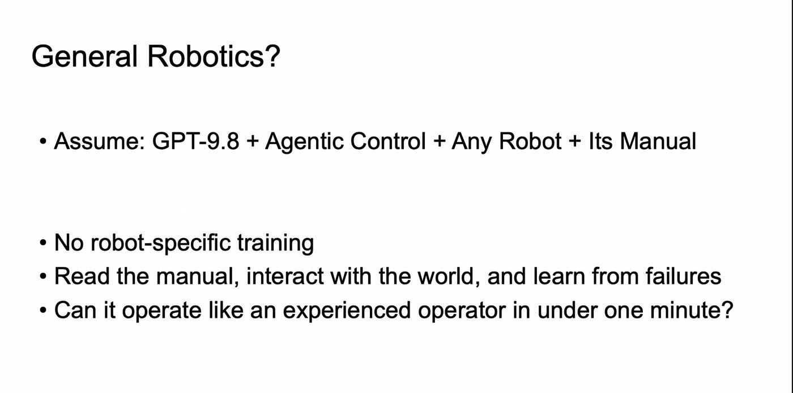<figcaption class="figcap"><b class="fl">Figure 4.</b> From Jianyuan Wang's talk on general robotics at IMW 2026; credit<a href="#ref-jwang">[20]</a>.</figcaption></figure>
<figure id="fig-astra">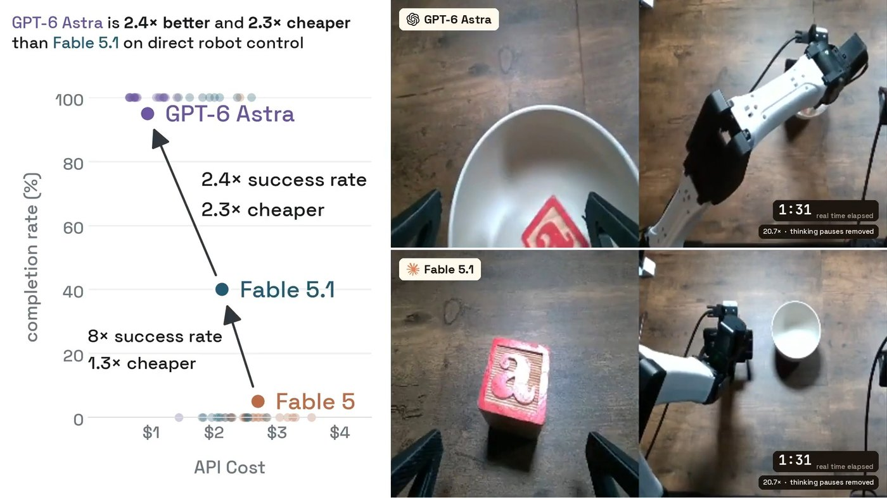<figcaption class="figcap"><b class="fl">Figure 5.</b> Zero-shot direct robot control with GPT-6 Astra; credit<a href="#ref-chooi" id="cite-chooi">[21]</a>.</figcaption></figure>

This suggests bringing the agent loop to the physical world, as in a recent robot-use agent<a href="#ref-isola" id="cite-isola">[22]</a>: a tool call moves the robot, the model reasons about what it sees, and the next camera frame starts the next turn. Meanwhile, frontier models such as GPT-6 Astra have shown strong zero-shot direct robot control ([Figure 5](#fig-astra))<a href="#ref-chooi">[21]</a>, and several recent demos operate robots this way<a href="#ref-cpr" id="cite-cpr">[23]</a><a href="#ref-robocurve" id="cite-robocurve">[24]</a><a href="#ref-waddle" id="cite-waddle">[25]</a>.

Open-weight models, however, have barely been tested on this, yet robot use needs them for two reasons. First, to understand how well language models manipulate objects and how to improve them, we need large amounts of reproducible data, which means a model we can serve ourselves and experiment with at an acceptable cost, rather than paying frontier-model API prices. Second, a deployed robot system built on an LLM must be fast and efficient enough to run on local hardware. That needs an open model small enough to deploy, and task data that only an open model makes affordable to collect.

### Where **ORA** fits {#landscape}

Methods that control robots with learned models fall into four families. They differ in the role of the language model and in how often it makes a decision ([Table 1](#tab-taxo)).

Vision-language-action (VLA) models<a href="#ref-rt2">[14]</a><a href="#ref-openpi">[3]</a><a href="#ref-openvla">[15]</a> and, more recently, world action models that also predict future video<a href="#ref-dreamzero">[16]</a><a href="#ref-gigaworld" id="cite-gigaworld">[26]</a> map camera images and an instruction to actions at every control step and are trained on the largest robot datasets. Because the vision-language backbone is fine-tuned into a visuomotor policy that outputs actions, these systems use little of its ability to reason and act as an agent, for example to measure before moving, plan several steps ahead or change approach after a failure.

A common response is to add a language model as a planner on top of a learned policy, the System 2 / System 1 design<a href="#ref-saycan" id="cite-saycan">[27]</a><a href="#ref-hirobot" id="cite-hirobot">[28]</a><a href="#ref-helix" id="cite-helix">[29]</a><a href="#ref-gr00t">[5]</a>. The language model splits the task into steps and the policy carries them out. In RPent<a href="#ref-rpent">[1]</a>, a language model directs a VLA policy using task-specific memory. The model can also command some motions itself, but most of the manipulation is still done by the VLA, which is trained on robot demonstrations.

A third family has the language model write the policy as code. Code as Policies<a href="#ref-cap" id="cite-cap">[30]</a> turns the scene and the task into a program that calls perception and control primitives. CaP-Agent0<a href="#ref-capx" id="cite-capx">[31]</a>, ASPIRE<a href="#ref-aspire" id="cite-aspire">[32]</a> and RATs<a href="#ref-rats" id="cite-rats">[33]</a> add an agent that runs the program, reads the outcome and revises it; ASPIRE and RATs also keep the skills that work. These methods need no robot demonstrations, and they are economical to run: the model is called once or a few times per task, and the program then runs without it. The price is that the program executes as one or a few open-loop segments. Getting it right often takes trial runs (ASPIRE, for example, learns its skills on separate seeds before it is tested), and between revisions no model looks at the scene: the program reacts only through the checks written into it, which limits how well it carries over to new scenes.

The fourth family runs the agent loop directly, in the ReAct style<a href="#ref-react" id="cite-react">[34]</a>: the model reasons, calls a tool, reads the result and decides again. Frontier models have controlled robots this way<a href="#ref-chooi">[21]</a><a href="#ref-cpr">[23]</a>, and Guava<a href="#ref-guava" id="cite-guava">[35]</a>, OpenRUA<a href="#ref-openrua" id="cite-openrua">[36]</a>, Agent as Policy<a href="#ref-agp" id="cite-agp">[37]</a> and Robo-Harness K1<a href="#ref-k1" id="cite-k1">[38]</a> are harnesses for such agents. When the model issued every low-level command itself, the best model in one study reached 5.5% on LIBERO<a href="#ref-cpr">[23]</a>. **ORA** is in this family. Each tool call covers one bounded motion, which a controller executes, and the model sees the result before its next decision. It costs a model call at every step, so at today's latencies and prices this family is slower and costlier to run than a program written once (see Cost and Limitations).

<table class="taxo"><thead><tr><th>Family</th><th>What the language model does</th><th>How often it decides</th><th>Robot data needed</th><th>Examples</th></tr></thead><tbody>
<tr><td>VLA and world action models</td><td>is trained into the motor policy</td><td>every control step</td><td>large robot datasets</td><td>RT-2<a href="#ref-rt2">[14]</a>, π0, π0.5<a href="#ref-openpi">[3]</a>, OpenVLA<a href="#ref-openvla">[15]</a>, DreamZero<a href="#ref-dreamzero">[16]</a></td></tr>
<tr><td>Planner + learned policy (System 2 / System 1)</td><td>directs a learned policy step by step</td><td>when the policy finishes a step</td><td>demonstrations to train the policy</td><td>SayCan<a href="#ref-saycan">[27]</a>, Hi Robot<a href="#ref-hirobot">[28]</a>, Helix<a href="#ref-helix">[29]</a>, GR00T N1<a href="#ref-gr00t">[5]</a>, RPent<a href="#ref-rpent">[1]</a></td></tr>
<tr><td>Code as policy</td><td>writes a program over perception and control primitives, runs it and revises it</td><td>once or a few times per task</td><td>none</td><td>Code as Policies<a href="#ref-cap">[30]</a>, CaP-Agent0<a href="#ref-capx">[31]</a>, ASPIRE<a href="#ref-aspire">[32]</a>, RATs<a href="#ref-rats">[33]</a></td></tr>
<tr class="ora"><td>Robot-use agent (ReAct loop)</td><td>calls a tool, reads the result and decides again</td><td>once per tool call</td><td>none</td><td>Guava<a href="#ref-guava">[35]</a>, OpenRUA<a href="#ref-openrua">[36]</a>, Agent as Policy<a href="#ref-agp">[37]</a>, Robo-Harness K1<a href="#ref-k1">[38]</a>, ORA</td></tr>
</tbody></table>

<b class="fl">Table 1.</b> Four families of methods that control robots with learned models, by the role of the language model and how often it decides. Some systems combine several families.

## How **ORA** works {#method}

**ORA** follows the practice of coding agents such as Claude Code<a href="#ref-claudecode" id="cite-claudecode">[39]</a> and Pi<a href="#ref-pi" id="cite-pi">[40]</a>: the task runs as a ReAct loop<a href="#ref-react">[34]</a> in which, every turn, the model reads its input, thinks and makes one tool call; the action changes the state of the world, and what comes back becomes the next turn's input ([Figure 6](#fig-system)). Like those agents, it has a prompt bundle, tools and context management, but for a robot each has to do more.

First, the **prompt bundle** has to describe the body of each embodiment and the task: the robot's frames, the point each command moves, the gripper's constants, and the task's success criteria written out in detail. Second, the **tool suite** has to help the model sense and act in the physical environment. In place of a shell and file reads and writes, the model sees the world only through cameras and the robot's sensors, so it needs perception tools that measure the real scene and action tools that act on the environment and report, after every action, exactly what happened. Third, compared with a coding agent, a robot-use agent receives a large volume of redundant visual observations and environment data, so **context management** has to carry much heavier input: every turn adds camera images, and the model keeps returning to earlier results. The input must stay small without losing those results or breaking the prompt cache.

On the other side is the environment: a supervisor checks every motion against the robot's limits, runs it and returns a measured receipt. Throughout, the model perceives the scene only through RGB and depth images and never sees privileged information from the simulator: the success check's code, object ground truth or simulator contacts.

<figure class="sfx sfx-flat" id="fig-system">

<button aria-controls="sfx-detail" aria-label="DeepSeek-V4.1-Flash: open details" class="sfx-hit sfx-model" data-node="model" type="button"><svg aria-hidden="true" class="sf-ic" height="20" viewbox="0 0 24 24" width="20"><g><path d="M4 5h16v11H11l-5 4v-4H4z"></path><path d="M12 7.5l1 2.2 2.2 1-2.2 1-1 2.2-1-2.2-2.2-1 2.2-1z"></path></g></svg><b>DeepSeek-V4.1-Flash</b>open weights</button>

<svg aria-hidden="true" viewbox="0 0 24 24"><path d="M19 12a7 7 0 1 1-2.1-5"></path><path d="M17.5 3.5v3.6h-3.6"></path></svg>

ORAthe harness

<section class="sfx-panel"><h5>Prompt Bundle</h5>
<button aria-controls="sfx-detail" aria-label="system policy: open details" class="sfx-hit sfx-mchip" data-node="system" type="button"><svg aria-hidden="true" class="sf-ic" height="15" viewbox="0 0 24 24" width="15"><g><path d="M7 7h10M7 11h10M7 15h6"></path></g></svg>system policy</button><button aria-controls="sfx-detail" aria-label="evidence rules: open details" class="sfx-hit sfx-mchip" data-node="rules" type="button"><svg aria-hidden="true" class="sf-ic" height="15" viewbox="0 0 24 24" width="15"><g><path d="M4 12.5l5 5L20 6"></path></g></svg>evidence rules</button><button aria-controls="sfx-detail" aria-label="benchmark: open details" class="sfx-hit sfx-mchip" data-node="env" type="button"><svg aria-hidden="true" class="sf-ic" height="15" viewbox="0 0 24 24" width="15"><path d="M3 16.5h18M5.5 16.5V20M18.5 16.5V20"></path><rect height="6.5" rx="1" width="6" x="9" y="10"></rect><path d="M12 10V6.5"></path></svg>benchmark</button><button aria-controls="sfx-detail" aria-label="robot card: open details" class="sfx-hit sfx-mchip" data-node="body" type="button"><svg aria-hidden="true" class="sf-ic" height="15" viewbox="0 0 24 24" width="15"><g><path d="M5 20h6M8 20v-5l5-5 4 2M17 12v4M15 18l2-2 2 2"></path><circle cx="8" cy="15" r="1.4"></circle><circle cx="13" cy="10" r="1.4"></circle></g></svg>robot card</button><button aria-controls="sfx-detail" aria-label="task: open details" class="sfx-hit sfx-mchip" data-node="task" type="button"><svg aria-hidden="true" class="sf-ic" height="15" viewbox="0 0 24 24" width="15"><g><circle cx="12" cy="12" r="8"></circle><circle cx="12" cy="12" r="4"></circle><circle cx="12" cy="12" r="0.8"></circle></g></svg>task</button><button aria-controls="sfx-detail" aria-label="tool schemas: open details" class="sfx-hit sfx-mchip" data-node="toolman" type="button"><svg aria-hidden="true" class="sf-ic" height="15" viewbox="0 0 24 24" width="15"><g><path d="M14.5 5.5a4 4 0 0 0-5 5L4 16l4 4 5.5-5.5a4 4 0 0 0 5-5l-2.5 2.5-2.5-.5-.5-2.5z"></path></g></svg>tool schemas</button><button aria-controls="sfx-detail" aria-label="round facts: open details" class="sfx-hit sfx-mchip" data-node="facts" type="button"><svg aria-hidden="true" class="sf-ic" height="15" viewbox="0 0 24 24" width="15"><g><circle cx="12" cy="12" r="7"></circle><path d="M12 2v5M12 17v5M2 12h5M17 12h5"></path></g></svg>round facts</button>
</section>
<section class="sfx-panel sfx-p-tools"><h5>Tool Suite<em>20 in this run</em></h5>

look<button aria-controls="sfx-detail" aria-label="vision_ground: open details" class="sfx-hit sfx-tool" data-node="vision_ground" type="button"><svg aria-hidden="true" viewbox="0 0 24 24"><path d="M4 8.5V6a2 2 0 0 1 2-2h2.5M15.5 4H18a2 2 0 0 1 2 2v2.5M20 15.5V18a2 2 0 0 1-2 2h-2.5M8.5 20H6a2 2 0 0 1-2-2v-2.5"></path><circle cx="11.3" cy="11.3" r="3.3"></circle><path d="M13.8 13.8l2.7 2.7"></path></svg>vision_groundfind by name</button><button aria-controls="sfx-detail" aria-label="vision_segment: open details" class="sfx-hit sfx-tool" data-node="vision_segment" type="button"><svg aria-hidden="true" viewbox="0 0 24 24"><path d="M4 8.5V6a2 2 0 0 1 2-2h2.5M15.5 4H18a2 2 0 0 1 2 2v2.5M20 15.5V18a2 2 0 0 1-2 2h-2.5M8.5 20H6a2 2 0 0 1-2-2v-2.5"></path><path d="M8.3 11.4c.5-2.6 3.6-3.8 5.8-2.7 2.1 1 2.5 3.9 1 5.6-1.6 1.8-4.8 1.9-6.2.3-.6-.8-.8-2-.6-3.2z" fill="currentColor" fill-opacity=".16"></path><circle cx="12" cy="12" fill="currentColor" r=".9" stroke="none"></circle></svg>vision_segmentmask at points</button><button aria-controls="sfx-detail" aria-label="mark_point: open details" class="sfx-hit sfx-tool" data-node="mark_point" type="button"><svg aria-hidden="true" viewbox="0 0 24 24"><circle cx="12" cy="12" r="6.8"></circle><path d="M12 2.8v4.4M12 16.8v4.4M2.8 12h4.4M16.8 12h4.4"></path><circle cx="12" cy="12" fill="currentColor" r="1.3" stroke="none"></circle></svg>mark_pointpixel → world</button>

measure<button aria-controls="sfx-detail" aria-label="geometry_query: open details" class="sfx-hit sfx-tool" data-node="geometry_query" type="button"><svg aria-hidden="true" viewbox="0 0 24 24"><path d="M8 16V4.8M8 16h11.2M8 16l-4.4 4.4"></path><path d="M6.2 6.6 8 4.8l1.8 1.8M17.4 14.2l1.8 1.8-1.8 1.8"></path><circle cx="15" cy="9" r="1.6"></circle><path d="M13.9 10.2 9 15" stroke-dasharray="1.5 1.8"></path></svg>geometry_querycamera ↔ world</button><button aria-controls="sfx-detail" aria-label="compute: open details" class="sfx-hit sfx-tool" data-node="compute" type="button"><svg aria-hidden="true" viewbox="0 0 24 24"><rect height="18" rx="2.2" width="14" x="5" y="3"></rect><path d="M8.5 7.2h7"></path><path d="M8.6 11.5h.01M12 11.5h.01M15.4 11.5h.01M8.6 15h.01M12 15h.01M15.4 15h.01M8.6 18.4h.01M12 18.4h.01M15.4 18.4h.01" stroke-width="2.3"></path></svg>computevector math</button><button aria-controls="sfx-detail" aria-label="grasp_plan: open details" class="sfx-hit sfx-tool" data-node="grasp_plan" type="button"><svg aria-hidden="true" viewbox="0 0 24 24"><path d="M12 2.8V5M7 5h10M7 5v6.2M17 5v6.2"></path><path d="M12 12.4v3" stroke-dasharray="1.4 1.6"></path><rect height="4.8" rx="1" width="6.8" x="8.6" y="16.2"></rect></svg>grasp_plangrasp proposals</button>

act<button aria-controls="sfx-detail" aria-label="move_pose: open details" class="sfx-hit sfx-tool" data-node="move_pose" type="button"><svg aria-hidden="true" viewbox="0 0 24 24"><path d="M5 19c1.6-6 5.6-10.4 12-11.8"></path><path d="M13.6 4.6 17.4 7.1l-2.5 3.8"></path><circle cx="5" cy="19" fill="currentColor" r="1.7" stroke="none"></circle></svg>move_posemove to a pose</button><button aria-controls="sfx-detail" aria-label="set_gripper: open details" class="sfx-hit sfx-tool" data-node="set_gripper" type="button"><svg aria-hidden="true" viewbox="0 0 24 24"><path d="M12 3v3M6.5 6h11M6.5 6v10M17.5 6v10"></path><path d="M9.6 12h4.8M11 10.6 9.6 12l1.4 1.4M13 10.6l1.4 1.4-1.4 1.4"></path></svg>set_gripperopen or close</button><button aria-controls="sfx-detail" aria-label="grasp_execute: open details" class="sfx-hit sfx-tool" data-node="act" type="button"><svg aria-hidden="true" viewbox="0 0 24 24"><path d="M11 2.8V4.6M6 4.6h10M6 4.6v8.2M16 4.6v8.2"></path><rect height="5.6" rx="1" width="6.8" x="7.6" y="8.6"></rect><path d="M3.5 20.5h15"></path><path d="M20 13.5V7.2M18.4 8.8 20 7.2l1.6 1.6"></path></svg>grasp_executerun a grasp</button>

also
<button aria-controls="sfx-detail" aria-label="observe: open details" class="sfx-hit sfx-mtool" data-node="observe" type="button">observe</button><button aria-controls="sfx-detail" aria-label="align_plan: open details" class="sfx-hit sfx-mtool" data-node="align_plan" type="button">align_plan</button><button aria-controls="sfx-detail" aria-label="move_to: open details" class="sfx-hit sfx-mtool" data-node="move_to" type="button">move_to</button><button aria-controls="sfx-detail" aria-label="rotate_wrist: open details" class="sfx-hit sfx-mtool" data-node="rotate_wrist" type="button">rotate_wrist</button><button aria-controls="sfx-detail" aria-label="rotate_pitch: open details" class="sfx-hit sfx-mtool" data-node="rotate_pitch" type="button">rotate_pitch</button><button aria-controls="sfx-detail" aria-label="recover_pose: open details" class="sfx-hit sfx-mtool" data-node="recover_pose" type="button">recover_pose</button><button aria-controls="sfx-detail" aria-label="wait_ticks: open details" class="sfx-hit sfx-mtool" data-node="wait_ticks" type="button">wait_ticks</button><button aria-controls="sfx-detail" aria-label="check_task: open details" class="sfx-hit sfx-mtool" data-node="check_task" type="button">check_task</button><button aria-controls="sfx-detail" aria-label="finish_episode: open details" class="sfx-hit sfx-mtool" data-node="finish_episode" type="button">finish_episode</button><button aria-controls="sfx-detail" aria-label="report_issue: open details" class="sfx-hit sfx-mtool" data-node="report_issue" type="button">report_issue</button><button aria-controls="sfx-detail" aria-label="artifact_read: open details" class="sfx-hit sfx-mtool" data-node="artifact_read" type="button">artifact_read</button>

</section>
<section class="sfx-panel"><h5>Context Management</h5>
<button aria-controls="sfx-detail" aria-label="this turn: open details" class="sfx-hit sfx-ctx" data-node="recent" type="button"><svg aria-hidden="true" viewbox="0 0 24 24"><rect height="12" rx="2" width="17" x="3.5" y="6.5"></rect><circle cx="12" cy="12.5" r="3.2"></circle><path d="M8.5 6.5l1.5-2h4l1.5 2"></path></svg>this turn<small>observation and receipt, in full</small></button><button aria-controls="sfx-detail" aria-label="recent turns: open details" class="sfx-hit sfx-ctx" data-node="window" type="button"><svg aria-hidden="true" viewbox="0 0 24 24"><path d="M4 5h11v7H8.5L5 15V5z"></path><path d="M15 9h5v8l-3-2.2h-6V12"></path></svg>recent turns<small>word for word</small></button><button aria-controls="sfx-detail" aria-label="older turns: open details" class="sfx-hit sfx-ctx" data-node="files" type="button"><svg aria-hidden="true" viewbox="0 0 24 24"><rect height="8" rx="1.2" width="9" x="3.5" y="4.5"></rect><path d="M5.5 11l2.2-2.4L10 11"></path><path d="M14 15.5a2.6 2.6 0 0 0 3.7 0l1.6-1.6a2.6 2.6 0 0 0-3.7-3.7l-.6.6"></path><path d="M17 13.5a2.6 2.6 0 0 0-3.7 0l-1.6 1.6a2.6 2.6 0 0 0 3.7 3.7l.6-.6"></path></svg>older turns<small>images → references</small></button><button aria-controls="sfx-detail" aria-label="history summary: open details" class="sfx-hit sfx-ctx" data-node="older" type="button"><svg aria-hidden="true" viewbox="0 0 24 24"><path d="M12 3v5.5M9 5.5l3 3 3-3"></path><path d="M12 21v-5.5M9 18.5l3-3 3 3"></path><path d="M5 12h14"></path></svg>history summary<small>finished rounds → checkpoints</small></button>
</section>

action<i></i>

<svg aria-hidden="true" viewbox="0 0 24 24"><path d="M19 12a7 7 0 1 1-2.1-5"></path><path d="M17.5 3.5v3.6h-3.6"></path></svg>every turn

observation<i></i>

trust boundary

Environment

diverse embodiments

<button aria-controls="sfx-detail" aria-label="ARX X5: open details" class="sfx-hit sfx-robot" data-node="arx" type="button">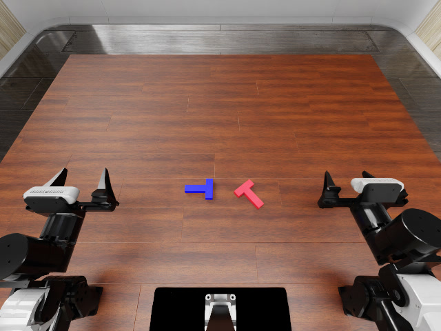ARX X5<small>RoboDojo · two arms</small></button><button aria-controls="sfx-detail" aria-label="ALOHA: open details" class="sfx-hit sfx-robot" data-node="aloha" type="button">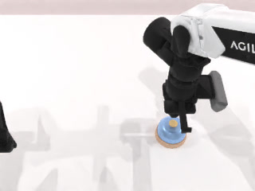ALOHA<small>RoboTwin · two arms</small></button><button aria-controls="sfx-detail" aria-label="Franka: open details" class="sfx-hit sfx-robot" data-node="franka" type="button">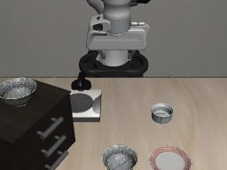Franka<small>LIBERO · one arm</small></button>
<button aria-controls="sfx-detail" aria-label="observation: open details" class="sfx-hit sfx-obs" data-node="obs" type="button">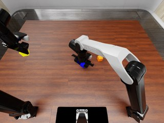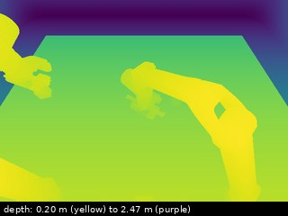<b>observation</b><small>RGB-D, robot state, receipt</small></button><button aria-controls="sfx-detail" aria-label="success check: open details" class="sfx-hit sfx-check" data-node="checker" type="button"><svg aria-hidden="true" class="sf-ic" height="13" viewbox="0 0 24 24" width="13"><g><path d="M6 21V4h11l-2.5 4 2.5 4H6"></path></g></svg>success check</button>

<figcaption class="figcap"><b class="fl">Figure 6.</b> The interaction loop between the LLM, ORA and the environment. Every turn, the model reads the prompt bundle and the context, thinks, and calls one tool; an action changes the world, and the observation that comes back, like every tool result, joins the context for the next turn. The prompt bundle and the context, rebuilt every turn with the newest material first, make up everything the model receives; on the other side, the environment holds the robots, returns an observation every turn and keeps the success check. Click any part to see it in detail.</figcaption>
</figure>

### Environment and observation {#sub-env}

We run **ORA** on three simulated benchmarks, each with its own robot ([Figure 7](#fig-cards)). They differ in the simulator and its world frame, the arms, the point each command moves, the gripper's geometry, the cameras and how success is judged. RoboDojo<a href="#ref-robodojo">[10]</a> runs on Isaac Sim<a href="#ref-isaacsim" id="cite-isaacsim">[41]</a> with a two-arm ARX X5; RoboTwin<a href="#ref-robotwin" id="cite-robotwin">[42]</a> runs on SAPIEN<a href="#ref-sapien" id="cite-sapien">[43]</a> with a two-arm ALOHA; LIBERO<a href="#ref-libero" id="cite-libero">[44]</a> and LIBERO-Pro<a href="#ref-liberopro" id="cite-liberopro">[45]</a> run on MuJoCo<a href="#ref-mujoco" id="cite-mujoco">[46]</a> through robosuite<a href="#ref-robosuite" id="cite-robosuite">[47]</a> with a one-arm Franka.

The loop, the kinds of tools and the model are shared; only the controllers are fitted to each robot. What differs reaches the model as text, through a benchmark boundary and a robot card. With these, one model runs all three robots. The card and the boundary give the agent the details of the body and the scene it needs to reason with, such as the point each command moves, where the fingers touch and how wide the jaws open; open a card below for them.

ARX X5RoboDojoFixed-base ARX X5: left 6-DoF arm, right 6-DoF arm; parallel-jaw grippers. Cameras: <code>head</code> fixed RGB-D; <code>left_wrist</code>, <code>right_wrist</code> moving RGB-D.
<table class="bodyfacts"><tbody><tr><th>Simulator</th><td>Isaac Sim<a href="#ref-isaacsim">[41]</a></td></tr><tr><th>Tasks we ran</th><td>42 multi-stage tabletop tasks, a first scan</td></tr><tr><th>Robot</th><td>ARX X5, two 6-DoF arms</td></tr><tr><th>Point a command moves</th><td>wrist flange; add no offset</td></tr><tr><th>Approach / jaw-closing axis</th><td>[1, 0, 0] / [0, 1, 0]</td></tr><tr><th>Where the fingers touch</th><td>jaw contact centre 0.150 m along the approach</td></tr><tr><th>Full jaw opening</th><td>88.8 mm</td></tr><tr><th>Cameras</th><td>one fixed, one on each wrist; 640 × 480</td></tr><tr><th>Official success</th><td>the benchmark's reward manager</td></tr></tbody></table>

ALOHARoboTwinFixed-base ALOHA-AgileX: left 6-DoF arm, right 6-DoF arm; parallel-jaw grippers. <code>right_tcp</code> is the controlled reference, 0.12 m from the flange; commands already target it.
<table class="bodyfacts"><tbody><tr><th>Simulator</th><td>SAPIEN<a href="#ref-sapien">[43]</a></td></tr><tr><th>Tasks we ran</th><td>50 tasks, 5 randomized scenes each</td></tr><tr><th>Robot</th><td>ALOHA-AgileX, two 6-DoF arms</td></tr><tr><th>Point a command moves</th><td>tool point 0.12 m beyond the flange</td></tr><tr><th>Approach / jaw-closing axis</th><td>[1, 0, 0] / [0, 1, 0]</td></tr><tr><th>Where the fingers touch</th><td>fingers from −50 to 36 mm around the tool point</td></tr><tr><th>Full jaw opening</th><td>94.9 mm, given in the <code>grasp_plan</code> help</td></tr><tr><th>Cameras</th><td>two fixed, one on each wrist; 320 × 240</td></tr><tr><th>Official success</th><td>the task's <code>check_success</code></td></tr></tbody></table>

FrankaLIBERO / LIBERO-ProFixed-base Franka Panda: right 7-DoF arm; parallel-jaw grippers. <code>right_grip_site</code> is the controlled reference, 0.097 m from the end-effector root; commands already target it.
<table class="bodyfacts"><tbody><tr><th>Simulator</th><td>MuJoCo<a href="#ref-mujoco">[46]</a> (robosuite<a href="#ref-robosuite">[47]</a>)</td></tr><tr><th>Tasks we ran</th><td>40 tasks × 10 seeds; LIBERO-Pro 8 suites × 100</td></tr><tr><th>Robot</th><td>Franka Panda, one 7-DoF arm</td></tr><tr><th>Point a command moves</th><td>grip site 0.097 m beyond the end-effector root</td></tr><tr><th>Approach / jaw-closing axis</th><td>[0, 0, 1] / [1, 0, 0]</td></tr><tr><th>Where the fingers touch</th><td>fingers from −44 to 9 mm around the grip site</td></tr><tr><th>Full jaw opening</th><td>80 mm</td></tr><tr><th>Cameras</th><td>one fixed, one on the wrist; 256 × 256</td></tr><tr><th>Official success</th><td>the environment's termination signal</td></tr></tbody></table>

<b class="fl">Figure 7.</b> The three embodiments and the opening of each robot card, verbatim. Open a card for what it and the benchmark boundary tell the model; the model never sees the success code, only its yes or no.

After every action, the environment returns an observation ([Figure 8](#fig-obs)). It holds an RGB image from each camera with its calibration, the measured pose and gripper of each arm, the receipt of the last action and the remaining budget, and it is paired with the observation the action was chosen from, so the model can compare before and after. Each camera's depth image is stored with the observation, and the looking tools read it when the model measures.

<figure class="obsfig" id="fig-obs">

<figure><figcaption>head camera, RGB</figcaption></figure><figure>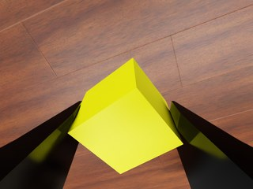<figcaption>left wrist, RGB</figcaption></figure><figure>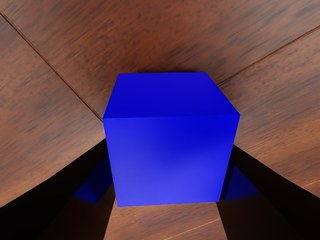<figcaption>right wrist, RGB</figcaption></figure><figure><figcaption>head camera, depth</figcaption></figure>

The package, as the model received it (shortened)

<ul class="sfx-tree"><li>comparison<ul class="sfx-tree"><li>action_input_actual_sequence7</li><li>action_result_actual_sequence8</li><li>availabletrue</li><li>instruction"Compare the retained ACTION INPUT ACTUAL with this ACTION RESULT ACTUAL before choosing the next tool."</li></ul></li><li>current_actual<ul class="sfx-tree"><li>observation_step8</li><li>camera_geometry<ul class="sfx-tree"><li>left_wrist…</li><li>right_wrist…</li></ul></li><li>public_robot_facts<ul class="sfx-tree"><li>end_effectors<ul class="sfx-tree"><li>right<ul class="sfx-tree"><li>pose_xyz_xyzw[0.001, -0.141, 0.934, -0.348, 0.619, 0.328, 0.623]</li><li>axes<ul class="sfx-tree"><li>approach_world[0.018, -0.023, -1.0]</li><li>closing_world[-0.84, 0.542, -0.028]</li></ul></li><li>gripper<ul class="sfx-tree"><li>command_target"close"</li><li>measured_opening_normalized0.51</li></ul></li></ul></li><li>left<ul class="sfx-tree"><li>pose_xyz_xyzw[-0.358, -0.131, 1.09, -0.402, 0.581, 0.403, 0.582]</li><li>axes…</li><li>gripper…</li></ul></li></ul></li><li>cameras…</li></ul></li></ul></li><li>last_action_effect<ul class="sfx-tree"><li>action"move_pose"</li><li>action_summary"right arm 1.6 mm / 0.6° from target, reached, TCP moved 163 mm"</li><li>detail…</li></ul></li><li>remaining_budget<ul class="sfx-tree"><li>native_actions_remaining352</li><li>native_actions_limit400</li><li>robot_decisions75</li><li>model_calls185</li></ul></li><li>images<ul class="sfx-tree t-list"><li>"ACTION RESULT ACTUAL · sequence 8 · head"</li><li>"ACTION RESULT ACTUAL · sequence 8 · left_wrist"</li><li>"ACTION RESULT ACTUAL · sequence 8 · right_wrist"</li></ul></li></ul>

<figcaption class="figcap"><b class="fl">Figure 8.</b> One observation on RoboDojo, from the run of <a class="figref" href="#fig-tui">Figure 3</a>, round 1, step 8: the three camera images the model receives, the head camera's depth image, which the looking tools read, and the package that comes with them.</figcaption></figure>

### Prompt Bundle {#sub-prompt}

A coding agent reads the repository and its instructions before it edits anything; a robot-use agent likewise has to be told enough about its environment before it moves. We therefore give it a prompt bundle of seven layers ([Figure 6](#fig-system)). A new embodiment therefore needs no training: only the embodiment context is replaced. Open any layer to read it as the model did in the run of [Figure 3](#fig-tui).

<ol class="ctx-layers pb-layers"><li>

<b>System policy</b>, the same for every robot and task: the turn protocol (read-only calls may be batched; a call that changes the world stands alone), every derived number goes to <code>compute</code>, how older evidence is replaced by references, and what the budgets mean.

System message, Native Robot Policy v4, excerpt
<pre class="sfx-quote"><b>Turn protocol</b>&#10;&#10;Read-only tools may be called sequentially or in one independent batch. A&#10;world-mutating tool must be the only tool call in its assistant response. Each&#10;accepted mutation ends the current turn; wait for the next actual observation&#10;before choosing another mutation.&#10;&#10;Arithmetic belongs in the advertised calculation capability, not in your own&#10;working. Whenever a number would be derived -- a residual, an offset along a&#10;direction, a quaternion unpacked, a sum of extents, a dot or cross product, a&#10;projection between image and world, a trigonometric value -- that derivation is&#10;part of how the action was chosen […]&#10;&#10;<b>How this context reaches you</b>&#10;&#10;Current actual evidence arrives complete on every turn. Earlier evidence is not&#10;guaranteed to stay in the form you first received it.&#10;&#10;A result that exceeds its inline budget is replaced by a status record carrying&#10;an exact reference to the complete original. […] Open the reference when you&#10;need what a past result said; call again when you need what is true now.&#10;&#10;<b>What the reported allowances mean</b>&#10;&#10;Every turn reports what remains of the current session round […]: accepted world&#10;mutations, model turns including read-only ones, and elapsed wall-clock seconds.&#10;[…] keep enough in hand to witness the effect of your final mutation and to take&#10;the advertised closing step: an unverified last action and an unclosed episode&#10;are both worse than one attempt fewer.</pre>
Verbatim from the prompt; […] marks a cut.

</li><li>

<b>Evidence rules</b>, also shared: keep direct evidence, inferences, candidates, executed commands and verified effects apart; after a failure, change what the next attempt rests on.

Evidence-to-Action Invariants v5, excerpt
<pre class="sfx-quote">Keep these states distinct:&#10;&#10;- **Direct evidence:** present in a current image, measurement or tool result.&#10;- **Inferred:** a task-relevant interpretation supported by observations.&#10;- **Candidate:** a proposed point, pose or action that has not executed.&#10;- **Executed:** a command the Runtime accepted and attempted.&#10;- **Verified:** a physical effect confirmed by a later observation.&#10;[…]&#10;<b>When something fails</b>&#10;&#10;A refusal, an error or an unchanged world is evidence about the approach, not&#10;only about the tool. Before repeating anything, change what the attempt rests&#10;on: refresh the evidence its arguments came from, or take a different route to&#10;the same effect. An identical call against an unchanged premise is not a&#10;recovery, and when two attempts fail the same way the premise is what to test.</pre>
Verbatim from the prompt; […] marks a cut.

</li><li>

<b>Benchmark boundary</b>, one per benchmark: the world frame and units, the table, the cameras, what stays private and where the official verdict comes from.

RoboDojo environment boundary, excerpt
<pre class="sfx-quote">The scene is a simulated Isaac Sim tabletop in an episode-local world frame:&#10;`+X` (red), `+Y` (green) and `+Z` (blue), `+Z` upward, positions in metres.&#10;One 1.4 m by 1.1 m table stands with its top near z = 0.76 m (table body&#10;centred at z = 0.74 m). The robot is mounted on the table's `-Y` side, so&#10;`+Y` runs from the robot toward the far edge. […]&#10;&#10;Simulator object and actor state, ground-truth poses, segmentation, contacts,&#10;evaluator objects, reward internals, the success-predicate implementation,&#10;task source and the teleoperated source demonstrations are private and&#10;unavailable.&#10;&#10;Only RoboDojo's reward manager supplies the official Boolean verdict,&#10;read through the advertised verdict query at a valid state boundary […]&#10;Every robot command reserves up to a fixed number of native actions (20) from&#10;that allowance; the receipt reports how many were consumed, and a refused&#10;command consumes none.</pre>
Verbatim from the prompt; […] marks a cut.

</li><li>

<b>Robot card</b>, one per robot: the arms, the point each command moves, the gripper's axes and constants, and the cameras (<a class="figref" href="#fig-cards">Figure 7</a>).

ARX X5 robot card, excerpt
<pre class="sfx-quote"><b>Identity and topology</b>&#10;Fixed-base ARX X5: left 6-DoF arm, right 6-DoF arm; parallel-jaw grippers.&#10;&#10;<b>Controlled points</b>&#10;`left_link6` is the left arm's controlled point, its wrist flange, not a fingertip;&#10;commands and measured poses already refer to it, so add no offset. […]&#10;&#10;<b>End-effector axes</b>&#10;`left_link6` local approach [1, 0, 0]; jaw-closing line [0, 1, 0]. Local Z is&#10;perpendicular to both. Current world directions are supplied with measured state.&#10;&#10;<b>Gripper semantics</b>&#10;[…] The jaw contact centre is +0.1501 m along the approach axis from `left_link6`. […]&#10;Nominal full-open pad separation is 88.8 mm. Physical pad aperture remains&#10;uncalibrated. The public encoder reading is the mean of both finger joints on the&#10;normalized command scale (empty-close reference about 0.185, full-open 1); it is&#10;not measured pad separation […]&#10;&#10;<b>Sensors and cameras</b>&#10;`head`: fixed RGB-D; use calibration from the same observation.&#10;`left_wrist`: arm-mounted moving RGB-D; use calibration from the same observation.&#10;`right_wrist`: arm-mounted moving RGB-D; use calibration from the same observation.</pre>
Verbatim from the prompt; […] marks a cut.

</li><li>

<b>Task and completion contract</b>, one per task: the benchmark's own instruction, copied unchanged, and a contract that restates the official success criteria in plain words.

Task message, RoboDojo stack_blocks_by_language, excerpt
<pre class="sfx-quote">stack the blocks from bottom to top in the order ofblue, yellow, and orange, then reset the robot arm.&#10;&#10;That sentence is the objective, in its exact words. […]&#10;&#10;Public completion contract for this task:&#10;&#10;- The three blocks must end up in one stack in the colour order the instruction&#10;  gives, read from the bottom up: the first colour named at the bottom, the&#10;  second in the middle and the third on top.&#10;- Each block must sit on top of the block below it, centred over it rather than&#10;  set off toward one side or placed beside it.&#10;- Both arms must be back at the poses they held when the episode reset, at the&#10;  same instant that everything else in this contract is true.</pre>
Verbatim from the prompt; […] marks a cut.

</li><li>

<b>Tool schemas</b>, for each tool, when to use it, what it changes and returns, what it does not do and how it refuses.

One of 20 schemas: vision_ground, shortened
<pre class="sfx-code">{"name": "vision_ground",&#10; "description": "Retrieve up to three inspectable text-grounded target proposals from one selected&#10;  current RGB-D camera. Use when: task language names an object or part and the scene-level search&#10;  space should be reduced before the policy makes its own identity decision […] Treat the returned&#10;  set as recall-oriented proposals: top rank and backend score are within-call ordering signals, not&#10;  an oracle. […] Does not: choose the correct candidate, guarantee that rank 0 is foreground, combine&#10;  cameras, expose object ground truth […] On error: Refused: max_candidates outside 1 to 3 […]",&#10; "parameters": {"camera": {"enum": ["head", "left_wrist", "right_wrist"]},&#10;                "text": {"type": "string", "maxLength": 120,&#10;                         "description": "Short visible object or part description, never a simulator identifier."},&#10;                "max_candidates": {"minimum": 1, "maximum": 3, "default": 3}}}</pre>
Verbatim from the prompt; […] marks a cut.

</li><li>

<b>Round facts</b>, once per round: the budgets, the first camera images, and what stays fixed within the round, such as fixed-camera calibration.

First observation and round static facts, round 1, shortened
<pre class="sfx-code">{"session_round": {"kind": "session_round_start", "round": 1, "total_rounds": 3, "budget_scope": "per_round",&#10;   "instruction": "This is a new independent environment round in the same AgentSession. […] Prior scene state&#10;   and coordinates are stale. Re-ground from the current observation and retain useful experience."},&#10; "remaining_budget": {"model_calls": 200, "robot_decisions": 80, "native_actions_remaining": 400,&#10;   "native_actions_limit": 400, "wall_time_s": 21091.7}, …}&#10;INITIAL ACTUAL · sequence 0 · head / left_wrist / right_wrist          [three images, 640×480]&#10;&#10;{"round_static_facts": {"current_actual": {&#10;   "camera_geometry": {"head": {"intrinsic_cv": [[288.13, 0.0, 320.0], [0.0, 288.13, 240.0], [0.0, 0.0, 1.0]],&#10;       "camera_origin_world_m": [0.0, -0.41, 1.308], "extrinsic_cv": […]}, "left_wrist": {…}, "right_wrist": {…}},&#10;   "conventions": {"camera_coordinates": "OpenCV: x right, y down, z forward", "depth_unit": "metres", …},&#10;   "view_dimensions": {"head": {"width": 640, "height": 480}, …}, "depth_delivery": "on_demand", …},&#10; "rule": "An observation in this round leaves out each current_actual field whose current value is&#10;   byte-identical to its value here. […]"}}</pre>
Verbatim from the prompt; […] marks a cut.

</li></ol>

The bundle says how to look and move. It never contains a solution, object coordinates or the success test. Three of its layers are specific to a robot task: the robot card, the task instruction copied unchanged from the benchmark, and the completion contract. See the [Analysis](#analysis) for the role of these components.

### Tool Suite {#sub-tools}

Each tool covers something the model cannot do reliably on its own ([Figure 9](#fig-toolbox)). The model sees only what the tools measure.

<figure class="sfx tbx" id="fig-toolbox">

look<button aria-pressed="false" class="tbx-b" data-node="vision_ground" type="button"><svg aria-hidden="true" viewbox="0 0 24 24"><path d="M4 8.5V6a2 2 0 0 1 2-2h2.5M15.5 4H18a2 2 0 0 1 2 2v2.5M20 15.5V18a2 2 0 0 1-2 2h-2.5M8.5 20H6a2 2 0 0 1-2-2v-2.5"></path><circle cx="11.3" cy="11.3" r="3.3"></circle><path d="M13.8 13.8l2.7 2.7"></path></svg><code>vision_ground</code><small>find by name</small></button><button aria-pressed="false" class="tbx-b" data-node="vision_segment" type="button"><svg aria-hidden="true" viewbox="0 0 24 24"><path d="M4 8.5V6a2 2 0 0 1 2-2h2.5M15.5 4H18a2 2 0 0 1 2 2v2.5M20 15.5V18a2 2 0 0 1-2 2h-2.5M8.5 20H6a2 2 0 0 1-2-2v-2.5"></path><path d="M8.3 11.4c.5-2.6 3.6-3.8 5.8-2.7 2.1 1 2.5 3.9 1 5.6-1.6 1.8-4.8 1.9-6.2.3-.6-.8-.8-2-.6-3.2z" fill="currentColor" fill-opacity=".16"></path><circle cx="12" cy="12" fill="currentColor" r=".9" stroke="none"></circle></svg><code>vision_segment</code><small>mask at points</small></button><button aria-pressed="false" class="tbx-b" data-node="mark_point" type="button"><svg aria-hidden="true" viewbox="0 0 24 24"><circle cx="12" cy="12" r="6.8"></circle><path d="M12 2.8v4.4M12 16.8v4.4M2.8 12h4.4M16.8 12h4.4"></path><circle cx="12" cy="12" fill="currentColor" r="1.3" stroke="none"></circle></svg><code>mark_point</code><small>pixel → world</small></button><button aria-pressed="false" class="tbx-b" data-node="observe" type="button"><code>observe</code><small>reopen or overlay images</small></button>

measure<button aria-pressed="false" class="tbx-b" data-node="geometry_query" type="button"><svg aria-hidden="true" viewbox="0 0 24 24"><path d="M8 16V4.8M8 16h11.2M8 16l-4.4 4.4"></path><path d="M6.2 6.6 8 4.8l1.8 1.8M17.4 14.2l1.8 1.8-1.8 1.8"></path><circle cx="15" cy="9" r="1.6"></circle><path d="M13.9 10.2 9 15" stroke-dasharray="1.5 1.8"></path></svg><code>geometry_query</code><small>camera ↔ world</small></button><button aria-pressed="false" class="tbx-b" data-node="compute" type="button"><svg aria-hidden="true" viewbox="0 0 24 24"><rect height="18" rx="2.2" width="14" x="5" y="3"></rect><path d="M8.5 7.2h7"></path><path d="M8.6 11.5h.01M12 11.5h.01M15.4 11.5h.01M8.6 15h.01M12 15h.01M15.4 15h.01M8.6 18.4h.01M12 18.4h.01M15.4 18.4h.01" stroke-width="2.3"></path></svg><code>compute</code><small>vector math</small></button><button aria-pressed="false" class="tbx-b" data-node="grasp_plan" type="button"><svg aria-hidden="true" viewbox="0 0 24 24"><path d="M12 2.8V5M7 5h10M7 5v6.2M17 5v6.2"></path><path d="M12 12.4v3" stroke-dasharray="1.4 1.6"></path><rect height="4.8" rx="1" width="6.8" x="8.6" y="16.2"></rect></svg><code>grasp_plan</code><small>grasp proposals</small></button><button aria-pressed="false" class="tbx-b" data-node="align_plan" type="button"><code>align_plan</code><small>reachable standoff poses</small></button>

act<button aria-pressed="false" class="tbx-b" data-node="move_pose" type="button"><svg aria-hidden="true" viewbox="0 0 24 24"><path d="M5 19c1.6-6 5.6-10.4 12-11.8"></path><path d="M13.6 4.6 17.4 7.1l-2.5 3.8"></path><circle cx="5" cy="19" fill="currentColor" r="1.7" stroke="none"></circle></svg><code>move_pose</code><small>move to a pose</small></button><button aria-pressed="false" class="tbx-b" data-node="set_gripper" type="button"><svg aria-hidden="true" viewbox="0 0 24 24"><path d="M12 3v3M6.5 6h11M6.5 6v10M17.5 6v10"></path><path d="M9.6 12h4.8M11 10.6 9.6 12l1.4 1.4M13 10.6l1.4 1.4-1.4 1.4"></path></svg><code>set_gripper</code><small>open or close</small></button><button aria-pressed="false" class="tbx-b" data-node="act" type="button"><svg aria-hidden="true" viewbox="0 0 24 24"><path d="M11 2.8V4.6M6 4.6h10M6 4.6v8.2M16 4.6v8.2"></path><rect height="5.6" rx="1" width="6.8" x="7.6" y="8.6"></rect><path d="M3.5 20.5h15"></path><path d="M20 13.5V7.2M18.4 8.8 20 7.2l1.6 1.6"></path></svg><code>grasp_execute</code><small>run a grasp</small></button><button aria-pressed="false" class="tbx-b" data-node="move_to" type="button"><code>move_to</code><small>move, keep orientation</small></button><button aria-pressed="false" class="tbx-b" data-node="rotate_wrist" type="button"><code>rotate_wrist</code><small>turn the jaw line</small></button><button aria-pressed="false" class="tbx-b" data-node="rotate_pitch" type="button"><code>rotate_pitch</code><small>tilt the approach</small></button><button aria-pressed="false" class="tbx-b" data-node="recover_pose" type="button"><code>recover_pose</code><small>return to a named pose</small></button><button aria-pressed="false" class="tbx-b" data-node="wait_ticks" type="button"><code>wait_ticks</code><small>let time pass</small></button>

episode<button aria-pressed="false" class="tbx-b" data-node="check_task" type="button"><code>check_task</code><small>ask for the official verdict</small></button><button aria-pressed="false" class="tbx-b" data-node="finish_episode" type="button"><code>finish_episode</code><small>end the round with a reason</small></button><button aria-pressed="false" class="tbx-b" data-node="report_issue" type="button"><code>report_issue</code><small>report an interface defect</small></button><button aria-pressed="false" class="tbx-b" data-node="artifact_read" type="button"><code>artifact_read</code><small>reopen a stored result</small></button>

<figcaption class="figcap"><b class="fl">Figure 9.</b> The 20 tools of the run in <a class="figref" href="#fig-tui">Figure 3</a>, by what they do. Click a tool for its schema, a real call and what came back.</figcaption></figure>

A language model can name what it sees but cannot point at it precisely, the reference gap DeepSeek describes<a href="#ref-dsvp" id="cite-dsvp">[48]</a>. The looking tools narrow it: `vision_ground` and `vision_segment` return SAM 3<a href="#ref-sam3" id="cite-sam3">[49]</a> masks for a named object or a few pointed pixels, `mark_point` measures single pixels, and each is looked up in depth, so the model gets positions in metres ([Figure 10](#fig-tools)).

<figure class="tcard">
<code>vision_ground</code>find an object by name · LIBERO-Pro

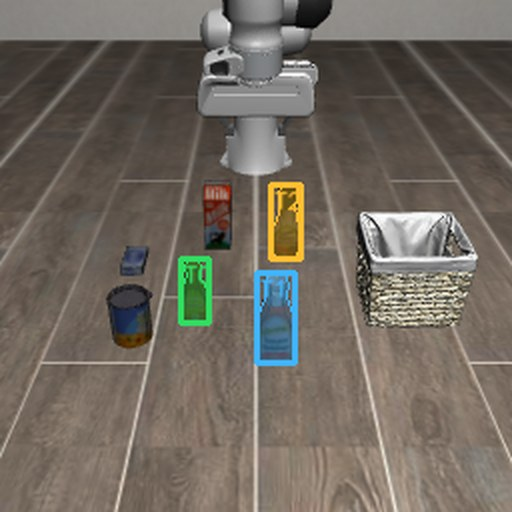

<code>vision_ground(camera="agentview", text="ketchup bottle")</code>

Three candidate bottles, each with a mask and a centre measured from depth. The top two scores are close (0.69 and 0.67), so the ranking alone does not settle which bottle is the ketchup; the model compares the close-ups before it grasps.
</figure><figure class="tcard">
<code>vision_segment</code>mask what the model points at · RoboDojo

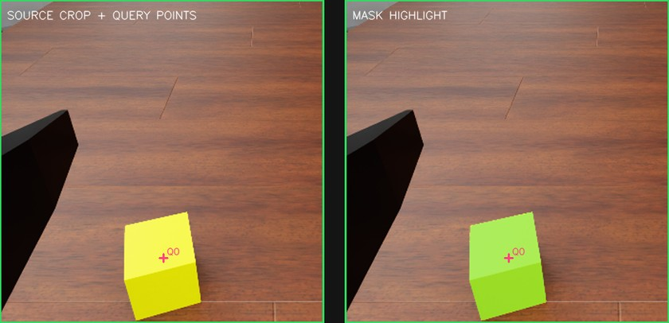

<code>vision_segment(camera="left_wrist", points_uv=[[215, 412]])</code>

One mask covering the yellow block: centre (−0.355, −0.142, 0.800) m, 36 × 37 mm, 35 mm above a surface at 0.765 m. A point the model chose on the head view a turn earlier had landed on the table.
</figure><figure class="tcard">
<code>mark_point</code>measure single pixels · RoboTwin

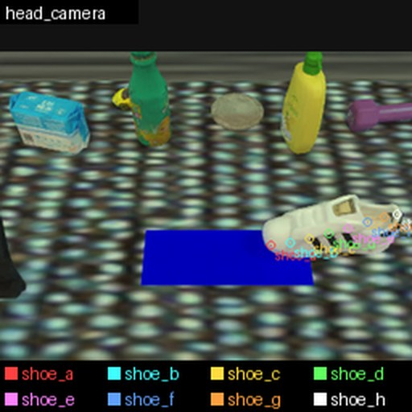

<code>mark_point(view="head_camera", point_ids=["shoe_a", …, "shoe_h"], …)</code>

The world positions of eight points along the shoe, all solved from depth, which give its length and heading on the table before the grasp is planned.
</figure><figure class="tcard">
<code>grasp_plan</code>propose grasps the arm can reach · LIBERO-Pro

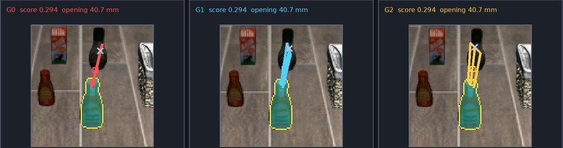

<code>grasp_plan(target_ref="target-dade139…", max_candidates=3)</code>

Three grasps on the chosen bottle from Contact-GraspNet, each with a 40.7 mm jaw opening for the Franka gripper, and all reachable.
</figure>

<b class="fl">Figure 10.</b> Four tool calls on LIBERO-Pro, RoboDojo and RoboTwin, each with the image it returned to the model and the numbers that came back. Click a tool in <a class="figref" href="#fig-system">Figure 6</a> for more calls from the run of <a class="figref" href="#fig-tui">Figure 3</a>.

The model also does geometry in its reasoning, sometimes wrongly: 12.2% of 35,270 responses derived vectors or rotations by hand, and three runs pointed the gripper up when they meant to approach from above. `compute` takes that arithmetic over, and a pose can be given as directions, such as approach straight down.

Motion tools take a target for the controlled point, never joints. The environment solves inverse kinematics and plans the path with cuRobo<a href="#ref-curobo" id="cite-curobo">[50]</a>, runs it and returns a receipt; a refusal says why, for instance that the straight path is reachable for only 75% of the way. `grasp_plan` proposes grasps with Contact-GraspNet<a href="#ref-cgn" id="cite-cgn">[51]</a>, and `grasp_execute` runs one as a single supervised sequence.

`check_task` returns the official yes or no, `finish_episode` ends a round early when a mistake cannot be undone, and `report_issue` lets the model flag a fault in the harness rather than in its own attempt.

See the [Analysis](#analysis) for the role of these components.

### Context Management {#sub-context}

A coding agent's turn adds a few lines of text; a robot's turn adds three camera images, measured poses and a receipt. Context management has to balance three goals that pull against each other. The input must stay short. Every earlier result must stay recoverable exactly, because the model often needs a number from many turns back: when we cut each observation to about half its length, rounding numbers and dropping limits, RoboDojo success fell from 17 to 10 of 27 rounds. And the start of the input must stay stable, so that the server's prompt cache keeps hitting, while every reduction breaks it.

**ORA** keeps the input in four layers, newest first ([Figure 6](#fig-system)). Open any layer to see it as the model received it.

<ol class="ctx-layers pb-layers"><li>

<b>This turn</b> arrives in full: the receipt of the last action, all three camera images, the measured poses and grippers, and the remaining budget, paired with the observation the action was chosen from.

One observation from round 1, shortened

<ul class="sfx-tree"><li>comparison<ul class="sfx-tree"><li>action_input_actual_sequence7</li><li>action_result_actual_sequence8</li><li>availabletrue</li><li>instruction"Compare the retained ACTION INPUT ACTUAL with this ACTION RESULT ACTUAL before choosing the next tool."</li></ul></li><li>current_actual<ul class="sfx-tree"><li>observation_step8</li><li>camera_geometry<ul class="sfx-tree"><li>left_wrist…</li><li>right_wrist…</li></ul></li><li>public_robot_facts<ul class="sfx-tree"><li>end_effectors<ul class="sfx-tree"><li>right<ul class="sfx-tree"><li>pose_xyz_xyzw[0.001, -0.141, 0.934, -0.348, 0.619, 0.328, 0.623]</li><li>axes<ul class="sfx-tree"><li>approach_world[0.018, -0.023, -1.0]</li><li>closing_world[-0.84, 0.542, -0.028]</li></ul></li><li>gripper<ul class="sfx-tree"><li>command_target"close"</li><li>measured_opening_normalized0.51</li></ul></li></ul></li><li>left<ul class="sfx-tree"><li>pose_xyz_xyzw[-0.358, -0.131, 1.09, -0.402, 0.581, 0.403, 0.582]</li><li>axes…</li><li>gripper…</li></ul></li></ul></li><li>cameras…</li></ul></li></ul></li><li>last_action_effect<ul class="sfx-tree"><li>action"move_pose"</li><li>action_summary"right arm 1.6 mm / 0.6° from target, reached, TCP moved 163 mm"</li><li>detail…</li></ul></li><li>remaining_budget<ul class="sfx-tree"><li>native_actions_remaining352</li><li>native_actions_limit400</li><li>robot_decisions75</li><li>model_calls185</li></ul></li><li>images<ul class="sfx-tree t-list"><li>"ACTION RESULT ACTUAL · sequence 8 · head"</li><li>"ACTION RESULT ACTUAL · sequence 8 · left_wrist"</li><li>"ACTION RESULT ACTUAL · sequence 8 · right_wrist"</li></ul></li></ul>

From the run's own records; … marks a cut.

</li><li>

<b>Recent turns</b> stay word for word: the images of the two most recent action steps stay inline, and the exact results of the last three.

Round 2's first exchange, still word for word at turn 30, shortened
<pre class="sfx-code">assistant: Round 2. Key lesson from round 1: after releasing a block, retract straight up before any lateral motion, and verify build-spot reachability both arms can satisfy. The layout is the same. Let me re-localize the blue block.&#10;&#10;tool (vision_segment): {"camera": "head", "candidate_previews": [{"crop_xyxy": [316, 209, 400, 293], "image_index": 1, "position": 0, …}], "candidates": [{"backend_score": 0.973, "candidate_id": "T0", "localization": {"center_xyz_m": [0.075, -0.140, 0.800], "extent_xyz_m": [0.039, 0.040, 0.033], …}}]}&#10;&#10;[two returned images, as references]</pre>
From the run's own records; … marks a cut.

</li><li>

<b>Older turns</b> keep their text, but every fourth action step their images, and any result over 50 KB, are replaced by exact references; <code>observe</code> or <code>artifact_read</code> reopens the bytes, and a large result keeps a 2 KB preview.

Round 1's first camera images, as references at turn 14
<pre class="sfx-code">INITIAL ACTUAL · sequence 0 · head · latest at this message &lt;recoverable_artifact&gt;{"at":[1,0],"bytes":409641,"mime":"image/png","open":"observe","ref":"artifact://…/d663528e…","v":1}&lt;/recoverable_artifact&gt;&#10;INITIAL ACTUAL · sequence 0 · left_wrist · latest at this message &lt;recoverable_artifact&gt;{"at":[1,0],"bytes":353088,"mime":"image/png","open":"observe","ref":"artifact://…/6fc7c0b4…","v":1}&lt;/recoverable_artifact&gt;&#10;…</pre>
From the run's own records; … marks a cut.

</li><li>

<b>History summary</b> takes over once the input passes about 150,000 tokens: the same model folds a completed round into one record, aimed at about 1,200 tokens, with the official result, what it learned and a reference to the exact transcript. If the input still reached 80% of the model's window, the oldest material would be compacted to 65%, as in Claude Code<a href="#ref-claudecode">[39]</a>.

Round 1's checkpoint, as read from turn 31 on, shortened

<ul class="sfx-tree"><li>coverage<ul class="sfx-tree"><li>action_step_count13</li><li>from_action_step_index0</li><li>through_action_step_index12</li></ul></li><li>official_verdict<ul class="sfx-tree"><li>round1</li><li>passedfalse</li><li>instruction"This completed-round result is exact. Reflect on durable task-local lessons."</li></ul></li><li>summary<ul class="sfx-tree"><li>confirmed_facts<ul class="sfx-tree t-list"><li>"Right-wrist measurement of the stranded block, re-projected into the head view, was self-consistent and placed it well beyond the table's far edge …"</li></ul></li><li>current_constraints<ul class="sfx-tree t-list"><li>"The stranded block is beyond the table's far edge and outside the commanded workspace, so neither arm can retrieve it; …"</li></ul></li><li>failed_attempts<ul class="sfx-tree t-list"><li><ul class="sfx-tree"><li>failure"Right-arm retraction after releasing the block displaced the block instead of leaving it in place."</li><li>evidence"After the clearing move the block was absent from the drop point and later measured beyond the far table edge."</li><li>correction"Clear with a short upward move first and re-observe, rather than a long diagonal retraction past the release point."</li></ul></li><li>…</li></ul></li><li>do_not_repeat<ul class="sfx-tree t-list"><li>"Do not resubmit world targets that already returned planner_failed for the same arm without changing standoff, height or arm."</li><li>…</li></ul></li><li>invalidated_beliefs…</li><li>re_ground_next…</li></ul></li><li>exact_transcript<ul class="sfx-tree"><li>bytes228007</li><li>open<ul class="sfx-tree"><li>tool"artifact_read"</li><li>arguments<ul class="sfx-tree"><li>ref"artifact://…/26c825a2…"</li></ul></li></ul></li></ul></li></ul>

From the run's own records; … marks a cut.

</li></ol>

To see the three goals at work, [Figure 11](#fig-loop) follows one long session: the RoboDojo block-stacking task of [Figure 3](#fig-tui), played three times in a row on the same scene, 123 turns in all.

The input stays short. In round 1 the input grew from 33k to 162k tokens, and at turns 14 and 18 the images of older steps became references. Round 2 began with round 1 still word for word; at 180k tokens, before turn 31, the model folded round 1 into a checkpoint, with its official result, a summary of facts, constraints, failed attempts and what not to repeat, and a reference to the 228 KB transcript. The input fell to 59k. Only completed rounds are folded, so round 2, which ran 65 turns, grew to 253k tokens with its older images turned into references nine times; it was folded the same way before turn 96, from 261k to 58k, and round 3 finished in 33 turns.

Nothing is lost. Every image or result that leaves the input becomes a reference to the exact stored bytes, which `observe` or `artifact_read` reopens. In the 250 RoboTwin cases, the model reopened earlier evidence 65 times, in 30 cases. In one, its left gripper had just clamped one handle of a pot; to plan the right handle, it read back the full `grasp_plan` result whose inline preview had been cut, 7,965 bytes of JSON, page by page.

The prefix stays stable. Between reductions, each request extends the previous one byte for byte, so the server can reuse its cache. In this session, 104 of the 122 later requests extended the previous one; the other 18 followed a reduction or opened a round, and they account for 82% of the uncached input. The estimated cache hit rate over the session was 86%, as in the evaluation runs (see Cost).

<figure class="sfx sfx-loopfig" id="fig-loop">

Round 125 turns · failed

<button aria-label="Turn 1: segment the blocks" aria-pressed="false" class="lp-t lp-ex" data-i="0" style="--h:13%" type="button"><i></i></button><button aria-label="Turn 2" aria-pressed="false" class="lp-t" data-i="1" style="--h:15%" type="button"><i></i></button><button aria-label="Turn 3: grasp yellow" aria-pressed="false" class="lp-t lp-ex" data-i="2" style="--h:18%" type="button"><i></i></button><button aria-label="Turn 4" aria-pressed="false" class="lp-t" data-i="3" style="--h:22%" type="button"><i></i></button><button aria-label="Turn 5" aria-pressed="false" class="lp-t" data-i="4" style="--h:23%" type="button"><i></i></button><button aria-label="Turn 6: move refused" aria-pressed="true" class="lp-t lp-ex" data-i="5" style="--h:24%" type="button"><i></i></button><button aria-label="Turn 7: switch arms" aria-pressed="false" class="lp-t lp-ex" data-i="6" style="--h:26%" type="button"><i></i></button><button aria-label="Turn 8" aria-pressed="false" class="lp-t" data-i="7" style="--h:28%" type="button"><i></i></button><button aria-label="Turn 9" aria-pressed="false" class="lp-t" data-i="8" style="--h:29%" type="button"><i></i></button><button aria-label="Turn 10" aria-pressed="false" class="lp-t" data-i="9" style="--h:32%" type="button"><i></i></button><button aria-label="Turn 11" aria-pressed="false" class="lp-t" data-i="10" style="--h:34%" type="button"><i></i></button><button aria-label="Turn 12" aria-pressed="false" class="lp-t" data-i="11" style="--h:37%" type="button"><i></i></button><button aria-label="Turn 13" aria-pressed="false" class="lp-t" data-i="12" style="--h:39%" type="button"><i></i></button><button aria-label="Turn 14" aria-pressed="false" class="lp-t lp-ref" data-i="13" style="--h:39%" type="button"><i></i></button><button aria-label="Turn 15" aria-pressed="false" class="lp-t" data-i="14" style="--h:41%" type="button"><i></i></button><button aria-label="Turn 16" aria-pressed="false" class="lp-t" data-i="15" style="--h:44%" type="button"><i></i></button><button aria-label="Turn 17: retract sideways" aria-pressed="false" class="lp-t lp-ex" data-i="16" style="--h:46%" type="button"><i></i></button><button aria-label="Turn 18" aria-pressed="false" class="lp-t lp-ref" data-i="17" style="--h:46%" type="button"><i></i></button><button aria-label="Turn 19" aria-pressed="false" class="lp-t" data-i="18" style="--h:48%" type="button"><i></i></button><button aria-label="Turn 20" aria-pressed="false" class="lp-t" data-i="19" style="--h:52%" type="button"><i></i></button><button aria-label="Turn 21" aria-pressed="false" class="lp-t" data-i="20" style="--h:55%" type="button"><i></i></button><button aria-label="Turn 22" aria-pressed="false" class="lp-t" data-i="21" style="--h:58%" type="button"><i></i></button><button aria-label="Turn 23" aria-pressed="false" class="lp-t" data-i="22" style="--h:59%" type="button"><i></i></button><button aria-label="Turn 24: find the lost block" aria-pressed="false" class="lp-t lp-ex" data-i="23" style="--h:61%" type="button"><i></i></button><button aria-label="Turn 25: give up" aria-pressed="false" class="lp-t lp-ex" data-i="24" style="--h:62%" type="button"><i></i></button>

Round 265 turns · success

<button aria-label="Turn 26: lesson from round 1" aria-pressed="false" class="lp-t lp-ex" data-i="25" style="--h:61%" type="button"><i></i></button><button aria-label="Turn 27" aria-pressed="false" class="lp-t" data-i="26" style="--h:63%" type="button"><i></i></button><button aria-label="Turn 28" aria-pressed="false" class="lp-t" data-i="27" style="--h:65%" type="button"><i></i></button><button aria-label="Turn 29" aria-pressed="false" class="lp-t" data-i="28" style="--h:67%" type="button"><i></i></button><button aria-label="Turn 30" aria-pressed="false" class="lp-t" data-i="29" style="--h:69%" type="button"><i></i></button><button aria-label="Turn 31: checkpoint" aria-pressed="false" class="lp-t lp-ex lp-ck" data-i="30" style="--h:23%" type="button"><i></i></button><button aria-label="Turn 32" aria-pressed="false" class="lp-t lp-ref" data-i="31" style="--h:23%" type="button"><i></i></button><button aria-label="Turn 33" aria-pressed="false" class="lp-t" data-i="32" style="--h:24%" type="button"><i></i></button><button aria-label="Turn 34" aria-pressed="false" class="lp-t" data-i="33" style="--h:26%" type="button"><i></i></button><button aria-label="Turn 35" aria-pressed="false" class="lp-t" data-i="34" style="--h:27%" type="button"><i></i></button><button aria-label="Turn 36" aria-pressed="false" class="lp-t" data-i="35" style="--h:29%" type="button"><i></i></button><button aria-label="Turn 37" aria-pressed="false" class="lp-t" data-i="36" style="--h:31%" type="button"><i></i></button><button aria-label="Turn 38" aria-pressed="false" class="lp-t" data-i="37" style="--h:34%" type="button"><i></i></button><button aria-label="Turn 39" aria-pressed="false" class="lp-t lp-ref" data-i="38" style="--h:35%" type="button"><i></i></button><button aria-label="Turn 40" aria-pressed="false" class="lp-t" data-i="39" style="--h:36%" type="button"><i></i></button><button aria-label="Turn 41" aria-pressed="false" class="lp-t" data-i="40" style="--h:39%" type="button"><i></i></button><button aria-label="Turn 42" aria-pressed="false" class="lp-t" data-i="41" style="--h:41%" type="button"><i></i></button><button aria-label="Turn 43" aria-pressed="false" class="lp-t" data-i="42" style="--h:44%" type="button"><i></i></button><button aria-label="Turn 44" aria-pressed="false" class="lp-t" data-i="43" style="--h:48%" type="button"><i></i></button><button aria-label="Turn 45" aria-pressed="false" class="lp-t" data-i="44" style="--h:50%" type="button"><i></i></button><button aria-label="Turn 46" aria-pressed="false" class="lp-t" data-i="45" style="--h:54%" type="button"><i></i></button><button aria-label="Turn 47" aria-pressed="false" class="lp-t" data-i="46" style="--h:57%" type="button"><i></i></button><button aria-label="Turn 48" aria-pressed="false" class="lp-t lp-ref" data-i="47" style="--h:57%" type="button"><i></i></button><button aria-label="Turn 49" aria-pressed="false" class="lp-t" data-i="48" style="--h:59%" type="button"><i></i></button><button aria-label="Turn 50" aria-pressed="false" class="lp-t" data-i="49" style="--h:55%" type="button"><i></i></button><button aria-label="Turn 51" aria-pressed="false" class="lp-t" data-i="50" style="--h:55%" type="button"><i></i></button><button aria-label="Turn 52" aria-pressed="false" class="lp-t" data-i="51" style="--h:58%" type="button"><i></i></button><button aria-label="Turn 53" aria-pressed="false" class="lp-t" data-i="52" style="--h:60%" type="button"><i></i></button><button aria-label="Turn 54" aria-pressed="false" class="lp-t" data-i="53" style="--h:62%" type="button"><i></i></button><button aria-label="Turn 55" aria-pressed="false" class="lp-t lp-ref" data-i="54" style="--h:60%" type="button"><i></i></button><button aria-label="Turn 56" aria-pressed="false" class="lp-t" data-i="55" style="--h:62%" type="button"><i></i></button><button aria-label="Turn 57" aria-pressed="false" class="lp-t" data-i="56" style="--h:65%" type="button"><i></i></button><button aria-label="Turn 58" aria-pressed="false" class="lp-t" data-i="57" style="--h:70%" type="button"><i></i></button><button aria-label="Turn 59" aria-pressed="false" class="lp-t" data-i="58" style="--h:73%" type="button"><i></i></button><button aria-label="Turn 60" aria-pressed="false" class="lp-t" data-i="59" style="--h:79%" type="button"><i></i></button><button aria-label="Turn 61" aria-pressed="false" class="lp-t" data-i="60" style="--h:81%" type="button"><i></i></button><button aria-label="Turn 62" aria-pressed="false" class="lp-t" data-i="61" style="--h:82%" type="button"><i></i></button><button aria-label="Turn 63" aria-pressed="false" class="lp-t" data-i="62" style="--h:84%" type="button"><i></i></button><button aria-label="Turn 64" aria-pressed="false" class="lp-t" data-i="63" style="--h:86%" type="button"><i></i></button><button aria-label="Turn 65" aria-pressed="false" class="lp-t lp-ref" data-i="64" style="--h:74%" type="button"><i></i></button><button aria-label="Turn 66" aria-pressed="false" class="lp-t" data-i="65" style="--h:75%" type="button"><i></i></button><button aria-label="Turn 67" aria-pressed="false" class="lp-t" data-i="66" style="--h:78%" type="button"><i></i></button><button aria-label="Turn 68" aria-pressed="false" class="lp-t" data-i="67" style="--h:80%" type="button"><i></i></button><button aria-label="Turn 69" aria-pressed="false" class="lp-t" data-i="68" style="--h:83%" type="button"><i></i></button><button aria-label="Turn 70" aria-pressed="false" class="lp-t" data-i="69" style="--h:86%" type="button"><i></i></button><button aria-label="Turn 71" aria-pressed="false" class="lp-t lp-ref" data-i="70" style="--h:78%" type="button"><i></i></button><button aria-label="Turn 72" aria-pressed="false" class="lp-t" data-i="71" style="--h:80%" type="button"><i></i></button><button aria-label="Turn 73" aria-pressed="false" class="lp-t" data-i="72" style="--h:82%" type="button"><i></i></button><button aria-label="Turn 74" aria-pressed="false" class="lp-t" data-i="73" style="--h:83%" type="button"><i></i></button><button aria-label="Turn 75" aria-pressed="false" class="lp-t lp-ref" data-i="74" style="--h:78%" type="button"><i></i></button><button aria-label="Turn 76" aria-pressed="false" class="lp-t" data-i="75" style="--h:80%" type="button"><i></i></button><button aria-label="Turn 77" aria-pressed="false" class="lp-t" data-i="76" style="--h:82%" type="button"><i></i></button><button aria-label="Turn 78" aria-pressed="false" class="lp-t" data-i="77" style="--h:83%" type="button"><i></i></button><button aria-label="Turn 79" aria-pressed="false" class="lp-t" data-i="78" style="--h:85%" type="button"><i></i></button><button aria-label="Turn 80" aria-pressed="false" class="lp-t" data-i="79" style="--h:87%" type="button"><i></i></button><button aria-label="Turn 81" aria-pressed="false" class="lp-t lp-ref" data-i="80" style="--h:86%" type="button"><i></i></button><button aria-label="Turn 82" aria-pressed="false" class="lp-t" data-i="81" style="--h:88%" type="button"><i></i></button><button aria-label="Turn 83" aria-pressed="false" class="lp-t" data-i="82" style="--h:89%" type="button"><i></i></button><button aria-label="Turn 84" aria-pressed="false" class="lp-t" data-i="83" style="--h:91%" type="button"><i></i></button><button aria-label="Turn 85" aria-pressed="false" class="lp-t lp-ref" data-i="84" style="--h:87%" type="button"><i></i></button><button aria-label="Turn 86" aria-pressed="false" class="lp-t" data-i="85" style="--h:88%" type="button"><i></i></button><button aria-label="Turn 87" aria-pressed="false" class="lp-t" data-i="86" style="--h:90%" type="button"><i></i></button><button aria-label="Turn 88" aria-pressed="false" class="lp-t" data-i="87" style="--h:95%" type="button"><i></i></button><button aria-label="Turn 89: verdict" aria-pressed="false" class="lp-t lp-ex" data-i="88" style="--h:96%" type="button"><i></i></button><button aria-label="Turn 90" aria-pressed="false" class="lp-t" data-i="89" style="--h:97%" type="button"><i></i></button>

Round 333 turns · success

<button aria-label="Turn 91: round 3 reuses round 2" aria-pressed="false" class="lp-t lp-ex" data-i="90" style="--h:92%" type="button"><i></i></button><button aria-label="Turn 92" aria-pressed="false" class="lp-t" data-i="91" style="--h:94%" type="button"><i></i></button><button aria-label="Turn 93" aria-pressed="false" class="lp-t" data-i="92" style="--h:96%" type="button"><i></i></button><button aria-label="Turn 94" aria-pressed="false" class="lp-t" data-i="93" style="--h:99%" type="button"><i></i></button><button aria-label="Turn 95" aria-pressed="false" class="lp-t" data-i="94" style="--h:100%" type="button"><i></i></button><button aria-label="Turn 96: second checkpoint" aria-pressed="false" class="lp-t lp-ex lp-ck" data-i="95" style="--h:22%" type="button"><i></i></button><button aria-label="Turn 97" aria-pressed="false" class="lp-t" data-i="96" style="--h:24%" type="button"><i></i></button><button aria-label="Turn 98" aria-pressed="false" class="lp-t" data-i="97" style="--h:26%" type="button"><i></i></button><button aria-label="Turn 99" aria-pressed="false" class="lp-t" data-i="98" style="--h:28%" type="button"><i></i></button><button aria-label="Turn 100" aria-pressed="false" class="lp-t" data-i="99" style="--h:29%" type="button"><i></i></button><button aria-label="Turn 101" aria-pressed="false" class="lp-t lp-ref" data-i="100" style="--h:29%" type="button"><i></i></button><button aria-label="Turn 102" aria-pressed="false" class="lp-t" data-i="101" style="--h:31%" type="button"><i></i></button><button aria-label="Turn 103" aria-pressed="false" class="lp-t" data-i="102" style="--h:32%" type="button"><i></i></button><button aria-label="Turn 104" aria-pressed="false" class="lp-t" data-i="103" style="--h:34%" type="button"><i></i></button><button aria-label="Turn 105" aria-pressed="false" class="lp-t" data-i="104" style="--h:37%" type="button"><i></i></button><button aria-label="Turn 106" aria-pressed="false" class="lp-t" data-i="105" style="--h:38%" type="button"><i></i></button><button aria-label="Turn 107" aria-pressed="false" class="lp-t lp-ref" data-i="106" style="--h:37%" type="button"><i></i></button><button aria-label="Turn 108" aria-pressed="false" class="lp-t" data-i="107" style="--h:39%" type="button"><i></i></button><button aria-label="Turn 109" aria-pressed="false" class="lp-t" data-i="108" style="--h:41%" type="button"><i></i></button><button aria-label="Turn 110" aria-pressed="false" class="lp-t" data-i="109" style="--h:42%" type="button"><i></i></button><button aria-label="Turn 111" aria-pressed="false" class="lp-t lp-ref" data-i="110" style="--h:44%" type="button"><i></i></button><button aria-label="Turn 112" aria-pressed="false" class="lp-t" data-i="111" style="--h:45%" type="button"><i></i></button><button aria-label="Turn 113" aria-pressed="false" class="lp-t" data-i="112" style="--h:46%" type="button"><i></i></button><button aria-label="Turn 114" aria-pressed="false" class="lp-t" data-i="113" style="--h:49%" type="button"><i></i></button><button aria-label="Turn 115" aria-pressed="false" class="lp-t" data-i="114" style="--h:53%" type="button"><i></i></button><button aria-label="Turn 116" aria-pressed="false" class="lp-t" data-i="115" style="--h:55%" type="button"><i></i></button><button aria-label="Turn 117" aria-pressed="false" class="lp-t lp-ref" data-i="116" style="--h:54%" type="button"><i></i></button><button aria-label="Turn 118" aria-pressed="false" class="lp-t" data-i="117" style="--h:56%" type="button"><i></i></button><button aria-label="Turn 119" aria-pressed="false" class="lp-t" data-i="118" style="--h:58%" type="button"><i></i></button><button aria-label="Turn 120" aria-pressed="false" class="lp-t" data-i="119" style="--h:60%" type="button"><i></i></button><button aria-label="Turn 121" aria-pressed="false" class="lp-t" data-i="120" style="--h:62%" type="button"><i></i></button><button aria-label="Turn 122: verdict, round 3" aria-pressed="false" class="lp-t lp-ex lp-ref" data-i="121" style="--h:63%" type="button"><i></i></button><button aria-label="Turn 123" aria-pressed="false" class="lp-t" data-i="122" style="--h:63%" type="button"><i></i></button>

<i class="k-ck"></i>checkpoint, a completed round folded (turns 31, 96)<i class="k-ref"></i>older images replaced by references (turns 14, 18, 32, 39, 48, 55, 65, 71, 75, 81, 85, 101, 107, 111, 117, 122)

One bar per turn, its height the provider-reported input tokens. Choose any turn, or one of these:

<button aria-pressed="false" class="lp-exb" data-i="0" type="button"><b>1</b>segment the blocks</button><button aria-pressed="false" class="lp-exb" data-i="2" type="button"><b>3</b>grasp yellow</button><button aria-pressed="true" class="lp-exb" data-i="5" type="button"><b>6</b>move refused</button><button aria-pressed="false" class="lp-exb" data-i="6" type="button"><b>7</b>switch arms</button><button aria-pressed="false" class="lp-exb" data-i="16" type="button"><b>17</b>retract sideways</button><button aria-pressed="false" class="lp-exb" data-i="23" type="button"><b>24</b>find the lost block</button><button aria-pressed="false" class="lp-exb" data-i="24" type="button"><b>25</b>give up</button><button aria-pressed="false" class="lp-exb" data-i="25" type="button"><b>26</b>lesson from round 1</button><button aria-pressed="false" class="lp-exb" data-i="30" type="button"><b>31</b>checkpoint</button><button aria-pressed="false" class="lp-exb" data-i="88" type="button"><b>89</b>verdict</button><button aria-pressed="false" class="lp-exb" data-i="90" type="button"><b>91</b>round 3 reuses round 2</button><button aria-pressed="false" class="lp-exb" data-i="95" type="button"><b>96</b>second checkpoint</button><button aria-pressed="false" class="lp-exb" data-i="121" type="button"><b>122</b>verdict, round 3</button>

<b>1</b>Read

<i class="sg-prompt" style="width:4.54%"></i><i class="sg-facts" style="width:2.81%"></i><i class="sg-earlier" style="width:8.45%"></i><i class="sg-new" style="width:2.00%"></i>

<i class="sg-prompt"></i>prompt 18k chars<i class="sg-facts"></i>round facts 11k chars<i class="sg-earlier"></i>earlier turns 33k chars<i class="sg-new"></i>new this turn 8.0k chars

64k input tokens · 17 images inline

The receipt of the lift (4.8 mm from target, reached, moved 126 mm) and three fresh camera images.

<b>2</b>Think
<blockquote>“Lift succeeded; the block is still held. Now translating horizontally above the blue block.”</blockquote>

<b>3</b>Act

<code class="c-fn">move_pose(</code><table class="sfx-args"><tr><th>targets</th><td><ul class="sfx-tree"><li>left<ul class="sfx-tree"><li>interaction"free_space"</li><li>orientation_mode"hold_current"</li><li>position_m[0.075, -0.14, 1.09]</li><li>position_mode"absolute"</li></ul></li></ul></td></tr></table><code class="c-fn">)</code>

<b>4</b>Result

Refused by the planner, nothing moved: the target above the blue block is 434 mm away, the straight path is reachable for 75% of the way, and the nearest reachable orientation tilts the gripper 15° from straight down.

<svg viewbox="0 0 24 24"><path d="M4 12h15M14 7l5 5-5 5"></path></svg>
<svg viewbox="0 0 24 24"><path d="M12 4v15M7 14l5 5 5-5"></path></svg>
<svg viewbox="0 0 24 24"><path d="M20 12H5M10 7l-5 5 5 5"></path></svg>
<svg viewbox="0 0 24 24"><path d="M12 20V5M7 10l5-5 5 5"></path></svg><em>next turn</em>

<svg aria-hidden="true" viewbox="0 0 24 24"><path d="M19 12a7 7 0 1 1-2.1-5"></path><path d="M17.5 3.5v3.6h-3.6"></path></svg><b id="lp-n">turn 6</b>

<figcaption class="figcap"><b class="fl">Figure 11.</b> The loop that runs every turn, on the run in Figure 3: the model reads its input, reasons, makes a call, and the result becomes part of the next turn's input. Choose any of the 123 turns on the timeline. Dark bars mark the two checkpoints, where a completed round was folded into one record; dots mark the turns where older images had just been replaced by references. Read says what changed before the turn. Its stacked bar measures text characters, excluding image content, on a shared 400k-character scale: the prompt, round facts, earlier turns and new evidence. The timeline and input-token total use provider-reported tokens. Character counts and token counts are different units.</figcaption>
</figure>

## Results {#results}

[Table 2](#tab-summary) repeats the main comparison. Every **ORA** run uses DeepSeek-V4.1-Flash zero-shot, with one attempt per case (one task with one seed), on the case lists of RPent<a href="#ref-rpent">[1]</a>; every rate counts all planned cases. **ORA**'s model may call the success check, which we have not confirmed for the RPent agents, so these compare complete systems rather than models.

<table class="mtab six stdlib sumtab"><thead><tr><th>Success %</th><th class="num">RoboTwin</th><th class="num">LIBERO-Pro</th><th class="num">LIBERO</th></tr></thead><tbody><tr class="ours"><td>ORA + DeepSeek-V4.1-Flash<small>open-weight model, zero-shot, no VLA</small></td><td class="num"><b>69.2</b></td><td class="num"><b>81.4</b></td><td class="num"><b>83.5</b></td></tr><tr><td>RPent + GPT-6 Astra<small>language model + VLA + task-specific memory</small></td><td class="num">—</td><td class="num">92.6</td><td class="num">—</td></tr><tr><td>RPent + Opus-4.7<small>language model + VLA + task-specific memory</small></td><td class="num">58.4</td><td class="num">82.4</td><td class="num">96.0</td></tr><tr><td>RPent + GPT-5.5<small>language model + VLA + task-specific memory</small></td><td class="num">62.4</td><td class="num">75.1</td><td class="num">—</td></tr><tr><td>Best end-to-end VLA<small>LingBot-VLA · π_RLinf · AtomVLA</small></td><td class="num">50.4</td><td class="num">50.0</td><td class="num">97.0</td></tr></tbody></table>

<b class="fl">Table 2.</b> The comparison of <a class="figref" href="#fig-main">Figure 2</a> across the three benchmarks. Other rows come from the RPent leaderboard<a href="#ref-rpent">[1]</a>; — means not reported. The best VLA is a different policy on each benchmark: LingBot-VLA<a href="#ref-lingbot">[6]</a>, π_RLinf<a href="#ref-pirl">[4]</a> and AtomVLA<a href="#ref-atomvla">[7]</a>.

### RoboTwin {#res-robotwin}

**ORA** leads on RoboTwin<a href="#ref-robotwin">[42]</a>, where all 250 cases use randomized scenes and we ran no pass on the clean ones; the RPent agents explore the clean scenes first to collect task memory. Its failures cluster ([Table 3](#tab-rtspread)): 31 of the 50 tasks are solved in at least four of five seeds, while eight tasks solved at most once account for 36 of the 77 failures. Most of these need both arms to work together or several objects moved in turn.

<table class="mtab rtspread"><thead><tr><th class="num">Seeds solved</th><th class="num">Tasks</th><th>RoboTwin tasks</th></tr></thead><tbody><tr><td class="num">5 of 5</td><td class="num">16</td><td class="tasks">blocks ranking rgb, click alarmclock, click bell, grab roller, move playingcard away, move stapler pad, open microwave, place a2b left, place a2b right, place burger fries, place mouse pad, place object stand, press stapler, shake bottle, shake bottle horizontally, stack bowls two</td></tr><tr><td class="num">4 of 5</td><td class="num">15</td><td class="tasks">adjust bottle, beat block hammer, blocks ranking size, handover mic, lift pot, move pillbottle pad, open laptop, place container plate, place empty cup, place object basket, place object scale, put object cabinet, rotate qrcode, stack blocks two, turn switch</td></tr><tr><td class="num">3 of 5</td><td class="num">7</td><td class="tasks">pick dual bottles, place bread basket, place cans plasticbox, place fan, place shoe, stack blocks three, stamp seal</td></tr><tr><td class="num">2 of 5</td><td class="num">4</td><td class="tasks">pick diverse bottles, place bread skillet, place phone stand, stack bowls three</td></tr><tr><td class="num">1 of 5</td><td class="num">4</td><td class="tasks">dump bin bigbin, handover block, move can pot, place can basket</td></tr><tr><td class="num">0 of 5</td><td class="num">4</td><td class="tasks">hanging mug, place dual shoes, put bottles dustbin, scan object</td></tr></tbody></table>

<b class="fl">Table 3.</b> RoboTwin tasks grouped by how many of their five seeds ORA solved, 250 cases in all.

### LIBERO {#res-libero}

On standard LIBERO<a href="#ref-libero">[44]</a>, **ORA** is below the VLA policies trained on LIBERO's own demonstrations. It is close on Spatial and Object (95% and 92%) and falls behind on Goal (84%) and Long (63%), whose tasks mostly chain two subtasks ([Table 4](#tab-libero)).

<table class="six stdlib"><thead><tr><th>LIBERO, success %</th><th class="num">Spatial</th><th class="num">Object</th><th class="num">Goal</th><th class="num">Long</th><th class="num">Overall</th></tr></thead><tbody><tr class="ours"><td>ORA + DeepSeek-V4.1-Flash<small>our harness + open-weight model · no VLA, robot training or task memory</small></td><td class="num">95.0</td><td class="num">92.0</td><td class="num">84.0</td><td class="num">63.0</td><td class="num"><b>83.5</b></td></tr><tr class=""><td>AtomVLA<a href="#ref-atomvla">[7]</a><small>VLA, trained on robot demos</small></td><td class="num">96.4</td><td class="num">99.6</td><td class="num">97.6</td><td class="num">94.4</td><td class="num"><b>97.0</b></td></tr><tr class=""><td>RPent + Opus-4.7<a href="#ref-rpent">[1]</a><small>RPent harness + language model + VLA + task-specific memory</small></td><td class="num">97.0</td><td class="num">100.0</td><td class="num">94.0</td><td class="num">93.0</td><td class="num"><b>96.0</b></td></tr><tr class=""><td>π_RLinf<a href="#ref-pirl">[4]</a><small>VLA, robot demos + RL</small></td><td class="num">99.0</td><td class="num">96.0</td><td class="num">97.0</td><td class="num">89.0</td><td class="num"><b>95.3</b></td></tr><tr class=""><td>π0<a href="#ref-openpi">[3]</a><small>VLA, trained on robot demos</small></td><td class="num">96.8</td><td class="num">98.8</td><td class="num">95.8</td><td class="num">85.2</td><td class="num"><b>94.2</b></td></tr><tr class=""><td>NORA<a href="#ref-nora" id="cite-nora">[52]</a><small>VLA, trained on robot demos</small></td><td class="num">85.6</td><td class="num">89.4</td><td class="num">80.0</td><td class="num">63.0</td><td class="num"><b>79.5</b></td></tr><tr class=""><td>OpenVLA<a href="#ref-openvla">[15]</a><small>VLA, trained on robot demos</small></td><td class="num">84.7</td><td class="num">88.4</td><td class="num">79.2</td><td class="num">53.7</td><td class="num"><b>76.5</b></td></tr></tbody></table>

<b class="fl">Table 4.</b> Success rates (%) on standard LIBERO by suite: 4 suites, 10 tasks each, 10 seeds per task. RPent and VLA rows are taken from the RPent leaderboard. Versions, infrastructure replacements and protocol differences are in the <a href="https://freemty.github.io/ora/appendix/">appendix</a>.

### LIBERO-Pro {#res-pro}

LIBERO-Pro<a href="#ref-liberopro">[45]</a> changes the task (Task suites) or moves the objects (Swap suites). **ORA** loses only two points against LIBERO and solves about as many Swap cases as Task cases (331 and 320 of 400), while VLA policies trained on LIBERO drop sharply: π_RLinf falls from 95.3% to 50.0% and AtomVLA from 97.0% to 6.3% ([Table 5](#tab-pro)). On the six suites that agents writing robot code report, **ORA** averages 89.2%, against 71.7% for ASPIRE<a href="#ref-aspire">[32]</a>, 43.8% for RATs<a href="#ref-rats">[33]</a> and 18.2% for CaP-Agent0<a href="#ref-capx">[31]</a>, under different protocols. OpenRUA<a href="#ref-openrua">[36]</a> reports 87.0% with Claude Opus 5; we have not compared its protocol with ours.

<table class="six stdlib protab"><thead><tr><th rowspan="2">LIBERO-Pro, success %</th><th class="num grp" colspan="2">Spatial</th><th class="num grp" colspan="2">Object</th><th class="num grp" colspan="2">Goal</th><th class="num grp" colspan="2">Long</th><th class="num" rowspan="2">Overall</th></tr><tr><th class="num">Task</th><th class="num">Swap</th><th class="num">Task</th><th class="num">Swap</th><th class="num">Task</th><th class="num">Swap</th><th class="num">Task</th><th class="num">Swap</th></tr></thead><tbody><tr class="ours"><td>ORA + DeepSeek-V4.1-Flash<small>our harness + open-weight model · no VLA, robot training or task memory</small></td><td class="num">98</td><td class="num">91</td><td class="num">93</td><td class="num">98</td><td class="num">77</td><td class="num">78</td><td class="num">52</td><td class="num">64</td><td class="num"><b>81.4</b></td></tr><tr class=""><td>RPent + GPT-6 Astra [a]<small>RPent harness + language model + VLA + task-specific memory</small></td><td class="num">100</td><td class="num">98</td><td class="num">100</td><td class="num">99</td><td class="num">88</td><td class="num">99</td><td class="num">85</td><td class="num">72</td><td class="num"><b>92.6</b></td></tr><tr class=""><td>RPent + Opus-4.7<a href="#ref-rpent">[1]</a><small>RPent harness + language model + VLA + task-specific memory</small></td><td class="num">—</td><td class="num">—</td><td class="num">—</td><td class="num">—</td><td class="num">—</td><td class="num">—</td><td class="num">—</td><td class="num">—</td><td class="num"><b>82.4</b></td></tr><tr class=""><td>RPent + GPT-5.5<small>RPent harness + language model + VLA + task-specific memory</small></td><td class="num">81</td><td class="num">69</td><td class="num">94</td><td class="num">91</td><td class="num">75</td><td class="num">66</td><td class="num">70</td><td class="num">55</td><td class="num"><b>75.1</b></td></tr><tr class=""><td>RPent Flash Mode [b]<a href="#ref-molmo2">[8]</a><small>RPent harness + Molmo2-8B + VLA + released task-specific memory</small></td><td class="num">79</td><td class="num">70</td><td class="num">86</td><td class="num">93</td><td class="num">74</td><td class="num">65</td><td class="num">60</td><td class="num">54</td><td class="num"><b>72.6</b></td></tr><tr class=""><td>RPent + Qwen3.6 27B<a href="#ref-qwen36">[2]</a><small>RPent harness + open-weight model + VLA + task-specific memory</small></td><td class="num">82</td><td class="num">78</td><td class="num">83</td><td class="num">84</td><td class="num">68</td><td class="num">68</td><td class="num">61</td><td class="num">41</td><td class="num"><b>70.6</b></td></tr><tr class=""><td>ASPIRE [c]<a href="#ref-aspire">[32]</a><small>LLM writes code + skill library</small></td><td class="num">60</td><td class="num">51</td><td class="num">95</td><td class="num">98</td><td class="num">45</td><td class="num">81</td><td class="num">38</td><td class="num">23</td><td class="num">—</td></tr><tr class=""><td>RATs<a href="#ref-rats">[33]</a><small>LLM writes code + skill library</small></td><td class="num">31</td><td class="num">29</td><td class="num">63</td><td class="num">61</td><td class="num">36</td><td class="num">43</td><td class="num">—</td><td class="num">—</td><td class="num">—</td></tr><tr class=""><td>CaP-Agent0<a href="#ref-capx">[31]</a><small>LLM writes code</small></td><td class="num">14</td><td class="num">12</td><td class="num">18</td><td class="num">22</td><td class="num">17</td><td class="num">26</td><td class="num">—</td><td class="num">—</td><td class="num">—</td></tr><tr class=""><td>π_RLinf<a href="#ref-pirl">[4]</a><small>VLA, robot demos + RL</small></td><td class="num">42</td><td class="num">59</td><td class="num">71</td><td class="num">78</td><td class="num">45</td><td class="num">42</td><td class="num">49</td><td class="num">14</td><td class="num"><b>50.0</b></td></tr><tr class=""><td>π0.5<a href="#ref-openpi">[3]</a><small>VLA, trained on robot demos</small></td><td class="num">1</td><td class="num">20</td><td class="num">1</td><td class="num">17</td><td class="num">2</td><td class="num">38</td><td class="num">1</td><td class="num">8</td><td class="num"><b>11.0</b></td></tr></tbody></table>

<b class="fl">Table 5.</b> Success rates (%) on the eight LIBERO-Pro suites, 10 tasks and 10 seeds each. Swap is the leaderboard's name for position perturbation. RPent and VLA rows come from the RPent leaderboard; — means not reported. [a] GPT-6 Astra uses separately frozen memory snapshots. [b] Flash Mode runs Molmo2-8B with released memory and reports the best of ten seeds. [c] ASPIRE learns skills on seeds 51–65 and tests on held-out seeds with Claude Opus 4.6, and its Long results transfer a LIBERO-90 skill library, so we give no overall rate for it. CaP-Agent0 is reported with 50 trials per condition. Exact counts are in the <a href="https://freemty.github.io/ora/appendix/">appendix</a>.

### RoboDojo: a first scan {#res-robodojo}

RoboDojo<a href="#ref-robodojo">[10]</a> is the hardest: 42 multi-stage tasks on a two-arm ARX X5. A first run with an earlier version of **ORA**, three rounds per task, solved 18 of 126 rounds and 9 of the 42 tasks at least once. Most of the 108 failed rounds failed in motion: the target was reasonable, but the motion did not achieve it ([Table 6](#tab-rdj)). This is not an evaluation, and we know of no published results on this task set.

<table class="mtab rdjtab"><thead><tr><th>Main cause of the failed round</th><th class="num">Rounds</th></tr></thead><tbody>
<tr><td>Motion did not achieve a reasonable target</td><td class="num">64</td></tr>
<tr><td>Strategy, order or tool use</td><td class="num">29</td></tr>
<tr><td>Perception or localization</td><td class="num">7</td></tr>
<tr><td>Simulator anomaly</td><td class="num">3</td></tr>
<tr><td>Gave up while recovery was still possible</td><td class="num">3</td></tr>
<tr><td>Undetermined</td><td class="num">2</td></tr>
</tbody></table>

<b class="fl">Table 6.</b> Main cause of each of the 108 failed rounds in the 42-task RoboDojo scan, one auditor judgement per round; 27 of the 64 motion cases are low-confidence.

### Preliminary results on a real robot {#real}

Everything above runs in simulation. We also connected **ORA** to a low-cost arm on a table, with a fixed RGB-D camera and a camera on the wrist, and gave DeepSeek-V4.1-Flash two household tasks: pull a small drawer open by its knob ([Figure 12](#fig-realdrawer)), and put a candy bar into a small open box ([Figure 13](#fig-realbar)). The loop is the one in simulation: the model reads the camera views and depth, plans each motion and reads what came back. An operator reviewed each motion before it ran. Both tasks were completed in these runs. We have not yet measured success rates.

<figure class="clip real" id="fig-realdrawer"><video aria-label="Real robot: open a drawer" controls="" height="256" playsinline="" poster="img/i-03e98ec0d5ee.jpg" preload="none" width="1280"><source src="img/videos/ora-real-drawer.mp4" type="video/mp4"/></video><figcaption class="figcap"><b class="fl">Figure 12.</b> <b>Open the drawer</b> (real robot). The model approaches the knob at 50°, closes both jaws on it, then pulls 4.5 cm twice, and the drawer comes 9 cm out. Left: the external camera; middle: the depth image the model received; right: the wrist camera. Time is sped up, and pauses while the model plans are shown as stills.</figcaption></figure>

<figure class="clip real" id="fig-realbar"><video aria-label="Real robot: put a candy bar in a box" controls="" height="360" playsinline="" poster="img/i-c4e443aa6334.jpg" preload="none" width="1120"><source src="img/videos/ora-real-bar.mp4" type="video/mp4"/></video><figcaption class="figcap"><b class="fl">Figure 13.</b> <b>Put the candy bar in the box</b> (real robot). After a 9 mm wrist correction the gripper closes on the bar, rises 13 cm, slides the bar over the opening and releases it, and the arm returns to its folded pose. Left: the external camera; right: the wrist camera. Time is sped up, and pauses while the model plans are shown as stills.</figcaption></figure>

### Cost {#cost}

We price every model call at DeepSeek's published off-peak rates for DeepSeek-V4.1-Flash<a href="#ref-dsprice" id="cite-dsprice">[53]</a>: $0.003 per million cached input tokens, $0.15 per million uncached input tokens and $0.60 per million output tokens. Off-peak prices are half the peak ones, so at peak rates every figure below doubles. We serve the model ourselves, so these are API-equivalent costs rather than what we paid. Every attempt counts, failures included; simulator and GPU costs are excluded.

<table class="mtab costtab"><thead><tr><th>Benchmark</th><th class="num">Attempts</th><th class="num">Solved</th><th class="num">Model calls<small>median</small></th><th class="num">Input tokens<small>median</small></th><th class="num">Cache hits<small>estimated</small></th><th class="num">Per attempt<small>mean / median</small></th><th class="num">Total</th><th class="num">Per solved case</th></tr></thead><tbody>
<tr><td>RoboTwin</td><td class="num">250</td><td class="num">173</td><td class="num">28</td><td class="num">3.7M</td><td class="num">86%</td><td class="num">$0.24 / $0.12</td><td class="num">$60.2</td><td class="num"><b>$0.35</b></td></tr>
<tr><td>LIBERO-Pro</td><td class="num">800</td><td class="num">651</td><td class="num">27</td><td class="num">3.1M</td><td class="num">84%</td><td class="num">$0.28 / $0.10</td><td class="num">$227.4</td><td class="num"><b>$0.35</b></td></tr>
<tr><td>LIBERO</td><td class="num">405</td><td class="num">334</td><td class="num">26</td><td class="num">2.9M</td><td class="num">84%</td><td class="num">$0.25 / $0.09</td><td class="num">$100.2</td><td class="num"><b>$0.30</b></td></tr>
<tr><td>RoboDojo</td><td class="num">126</td><td class="num">18</td><td class="num">55.5</td><td class="num">11.0M</td><td class="num">86%</td><td class="num">$0.39 / $0.35</td><td class="num">$49.2</td><td class="num">$2.74</td></tr>
</tbody></table>

<b class="fl">Table 7.</b> API-equivalent model cost of the evaluation runs reported above, at DeepSeek's off-peak USD rates for DeepSeek-V4.1-Flash. LIBERO counts 400 scored cases and 5 attempts that ended in an infrastructure failure and were rerun. The RoboDojo row counts the 126 rounds of the first RoboDojo run in Results (42 tasks, three rounds each, an earlier harness version), which is not an evaluation.

Most of the cost is uncached input: on LIBERO-Pro, $157 of $227, against $54 for output and $17 for cached input. Costs are also skewed. The median attempt costs well under half the mean, because long failing attempts keep adding input; a solved attempt costs $0.11 to $0.14 on average, and the 40 solved rounds in [Figure 1](#fig-hero) cost $0.13 each. An attempt produces about 100k output tokens.

Our server does not report prompt-cache hits, so we reconstruct them from token counts. A call whose input contains the whole previous request and response extends it, and that prefix counts as a hit; any other call breaks the prefix, and only the fixed prompt at its start counts. 86–89% of calls extend the previous one, which gives the estimated hit rates of 84–86% in the table. The remaining calls follow a context reduction or open a new round, and they produce 83–89% of all uncached tokens. Since uncached input is the largest cost, the main way to cut cost is to break the prefix less often.

## Analysis: what the harness contributes {#analysis}

Earlier we argued that a robot needs more from the harness than a coding agent does. Each part came out of audits of failed runs; here we compare run versions and examine individual cases. Most comparisons do not isolate one component. Every video plays all of its panes at the same simulated-time speed, and each takeaway states its evidence and its limits.

### Learning from experience {#an-learn}

Context management keeps a finished round in the input, word for word at first and then as a checkpoint. **ORA** keeps no memory from one task to the next, and the benchmark runs above use one round per case, but within one session the model can draw on its earlier rounds. In [Figure 14](#fig-rounds), each second round opens by stating what went wrong in the first and then avoids it; in the top row, the run of [Figure 3](#fig-tui), round 1 lost the blue block when the arm moved sideways after releasing it, and round 2 began by stating the rule to lift straight up first.

<figure class="clip cmp" id="fig-rounds"><video aria-label="Learning across rounds: RoboDojo and RoboTwin" controls="" playsinline="" poster="img/i-7975d47a86e2.jpg" preload="none"><source src="img/videos/ora-rounds.mp4" type="video/mp4"/></video><figcaption class="figcap"><b class="fl">Figure 14.</b> Two sessions, one per row: the failed round 1 (left), the lesson the model stated at the start of round 2 (yellow) and the successful round 2 on the same scene (right). Top: RoboDojo, stacking blocks; round 1 drags the blue block off the table while retracting. Bottom: RoboTwin, opening a laptop; round 1 pushes the half-open lid shut from above. Both sessions were chosen after seeing the outcome, and the RoboTwin one is outside the reported evaluation.</figcaption></figure>

**Takeaway: in the examples above, the model uses retained context to revise its approach. Across 148 two-round development sessions, round 2 succeeded in 72 and round 1 in 63. This comparison does not isolate the effect of retained context from the benefit of another attempt.**

### Exact task instructions and success criteria matter {#cs-task}

The prompt bundle states the task in two parts: the benchmark's instruction, unchanged, and a completion contract that restates the official success test in plain words. When an early run set paraphrased one LIBERO-Spatial task, writing “the top layer of the wooden cabinet” for “the top drawer”, the model took the bowl standing on the cabinet instead of the one in the drawer ([Figure 15](#fig-pairtask)). An instruction can also leave out part of the test: RoboTwin's “hold the bottle head up” also requires carrying the bottle toward the side its base pointed to, and “move the playing card away from the near edge” requires the card to end far to the left or right. Without the contract, the model satisfied the words and failed the check ([Figure 16](#fig-paircontract)).

<figure class="clip cmp" id="fig-pairtask"><video aria-label="Paraphrase and the benchmark words: LIBERO" controls="" playsinline="" poster="img/i-0fb64b759773.jpg" preload="none"><source src="img/videos/ora-cs-task.mp4" type="video/mp4"/></video><figcaption class="figcap"><b class="fl">Figure 15.</b> LIBERO-Spatial, two seeds. Left: the paraphrased instruction, and the wrong bowl. Right: the benchmark's words, and the bowl from the drawer placed on the plate.</figcaption></figure>

<figure class="clip cmp" id="fig-paircontract"><video aria-label="Without and with the completion contract: RoboTwin" controls="" playsinline="" poster="img/i-5c3be6d61385.jpg" preload="none"><source src="img/videos/ora-cs-contract.mp4" type="video/mp4"/></video><figcaption class="figcap"><b class="fl">Figure 16.</b> RoboTwin, the same seed on each row, without the contract (left) and with it (right). Top: the bottle is stood upright and never carried; with the contract it is carried toward the side its base pointed to. Bottom: the card box is moved from spot to spot through ten failed checks; with the contract it is carried to the left edge and released.</figcaption></figure>

**Takeaway: the run version using the benchmark's own words succeeded on 10 of 10 seeds, versus 2 of 10 for the version using a paraphrase. On 206 paired RoboTwin cases, the version with the completion contract succeeded on 64.1%, versus 53.4% without it. Other harness components also changed, so neither comparison isolates the effect of wording or the contract.**

### Perception tools help find and locate objects {#cs-perception}

The looking tools turn the model's naming and pointing into masks with measured positions and sizes ([Figure 10](#fig-tools)). Early runs show why the model needs them. Its own points are not precise enough: in one LIBERO run, points chosen on the angled camera landed on the supporting surface instead of the object, and moving a point 7 to 14 pixels merged the can with the table in the mask; the size of the returned mask made the error visible. Its choice among look-alike objects is not reliable either: when text grounding ranked the wrong can first, enlarged close-ups of each candidate let the model pick the right one. Later runs repeat the second pattern ([Figure 17](#fig-csperception)).

<figure class="clip cmp" id="fig-csperception"><video aria-label="Text grounding ranks look-alike objects close together: LIBERO-Pro and RoboTwin" controls="" playsinline="" poster="img/i-6f48175ec12d.jpg" preload="none"><source src="img/videos/ora-cs-perception.mp4" type="video/mp4"/></video><figcaption class="figcap"><b class="fl">Figure 17.</b> Two solved runs where text grounding scored look-alike objects close together, and in LIBERO-Pro ranked the wrong bottle first: what the tool returned (left) and what the model did with it (right).</figcaption></figure>

**Takeaway: from single early runs and with no matched ablation yet, the tools make pointing and identity errors visible, while choosing the right object stays the hardest step.**

### Exact constants and measurements {#cs-measure}

The tool suite gives the model measurements instead of its own estimates, and the measurement has to be the one the action needs. For placement, the tools first returned the centre of the target's mask as LIBERO's angled camera sees it, 2–3 cm from the object's centre on the table and about the whole placement tolerance. They now return the centre as seen from above ([Figure 18](#fig-csmeasure)). More generally, giving the model exact coordinates and the environment's constants, in tool results and in the system prompt, matters a great deal for its reasoning. Astranomy finds the same for GPT-6 Astra: as a direct robot policy, its success rose from 19.3% to 72.7% when the prompt added camera and gripper geometry<a href="#ref-astranomy" id="cite-astranomy">[54]</a>.

<figure class="clip cmp" id="fig-csmeasure"><video aria-label="Placement centre from the camera and from above: LIBERO" controls="" playsinline="" poster="img/i-4a5bff6b6417.jpg" preload="none"><source src="img/videos/ora-cs-measure.mp4" type="video/mp4"/></video><figcaption class="figcap"><b class="fl">Figure 18.</b> Two long LIBERO tasks, the same initial state on each row: with the centre seen from the camera, the placement misses (left); with the centre seen from above, it lands (right).</figcaption></figure>

**Takeaway: returning the centre seen from above raised success on the two affected task families from 29 to 42 of 59 test states.**

### Explaining refused motions helps recovery {#cs-feedback}

Motion tools report back after every action, and a refusal says why. Early on, when the planner found no inverse-kinematics solution and the refusal gave no reason, RoboDojo runs abandoned the target as unreachable, although most such targets were reachable with the gripper tilted; a bare error message once led a GPT-6 Astra run to repeat the same call 14 times in five minutes. A refusal now reports how far along the straight path the arm can reach and the nearest reachable orientation. In the run of [Figure 3](#fig-tui), turn 6 was refused this way, with 75% of the path reachable and a 15° tilt as the nearest reachable orientation; the model moved the build spot to where both arms could reach, and after one more refused move with the left arm it grasped the blue block with the right arm ([Figure 11](#fig-loop)). [Figure 19](#fig-csfeedback) shows two more runs: in RoboTwin, the reported reach made the model set the block down and relay it with the other arm; in LIBERO-Pro, the model took the reachable orientation the refusal offered.

<figure class="clip cmp" id="fig-csfeedback"><video aria-label="Refused moves and what the model did next: RoboTwin and LIBERO-Pro" controls="" playsinline="" poster="img/i-0c107fb5c767.jpg" preload="none"><source src="img/videos/ora-cs-feedback.mp4" type="video/mp4"/></video><figcaption class="figcap"><b class="fl">Figure 19.</b> Two solved runs with refused moves: the refusal and the model's reading of it (left) and what it did next (right).</figcaption></figure>

**Takeaway: replayed offline over 77 refused moves, a refusal that names the nearest reachable orientation resolves 69.**

The [gallery](https://freemty.github.io/ora/gallery/) shows 153 solved episodes, one per task, each checked by eye.

## Limitations {#limitations}

**ORA** shows that an open-weight model can operate robots zero-shot, but it has clear limits. First, it is slow: a median episode takes 14 to 25 minutes, most of it spent waiting for the model, and the simulator pauses while the model thinks, so these results say nothing about real-time control. Long-horizon tasks remain hard: the Long suites succeed 52–64% of the time, and the first RoboDojo scan solved 18 of 126 rounds. Second, the tool suite is written by hand, and **ORA** cannot yet iterate on or revise its tools automatically. Almost all of our results come from simulation and from one model, DeepSeek-V4.1-Flash; on the real robot we have only two demonstrations, with an operator approving each motion. Our success rates use each benchmark's official check, which ends the episode the moment its condition holds, and some conditions are looser than the instruction: RoboTwin's shake tasks only check that the bottle is raised. When we watched one solved RoboTwin episode per task, 7 of 46 did not do what the instruction asks, so the reported rates overstate real task completion. This task-selected sample cannot establish a corrected overall success rate. Most of our findings come from reading failed runs, not from controlled ablations. Next, we will run **ORA** on more real robots and turn verified episodes into training data for a smaller model that runs on the robot.

## Acknowledgements {#ack}

We thank the RPent team for releasing their evaluation cases, leaderboard and code, on which the comparisons in this post rely<a href="#ref-rpent">[1]</a>; the authors of CaP-X<a href="#ref-capx">[31]</a> and ASPIRE<a href="#ref-aspire">[32]</a>, whose work inspired our tools; and DeepSeek for releasing DeepSeek-V4.1-Flash as an open-weight model<a href="#ref-deepseek">[9]</a>. We thank [Zhaoning Wang](https://www.zhaoningwang.com/) for deploying **ORA** on the real robot, and [Junda Chen](https://github.com/GindaChen/), [Runyu Lu](https://runyulu.com/) and [Nan Xue](https://xuenan.net/) for helpful discussions.

## Citation {#citation-sec}

<button id="bib-copy" type="button">Copy</button><pre><code id="bib-text">@misc{ora2026,&#10;  title        = {{ORA}: Open Robot-Use Agents},&#10;  author       = {Yang, Yuanbo and Chen, Siyi and Gao, Jun and Zhang, Hao},&#10;  year         = {2026},&#10;  month        = oct,&#10;  howpublished = {Hao AI Lab blog},&#10;  url          = {https://haoailab.com/blogs/ora/}&#10;}</code></pre>

## References {#references}

<ol class="refs"><li id="ref-rpent">Yixian Zhang et al. Harness VLA: Steering Frozen VLAs into Reliable Manipulation Primitives via Memory-Guided Agents. arXiv:2607.08448, 2026. Code and leaderboard: RPent (RLinf). <a href="https://arxiv.org/abs/2607.08448">arxiv.org/abs/2607.08448</a> <a aria-label="Back to the text" class="back" href="#cite-rpent">↩</a></li><li id="ref-qwen36">Qwen Team. Qwen3.6-27B. Model card, 2026. <a href="https://huggingface.co/Qwen/Qwen3.6-27B">huggingface.co/Qwen/Qwen3.6-27B</a> <a aria-label="Back to the text" class="back" href="#cite-qwen36">↩</a></li><li id="ref-openpi">Physical Intelligence. openpi. Software, 2025. <a href="https://github.com/Physical-Intelligence/openpi">github.com/Physical-Intelligence/openpi</a> <a aria-label="Back to the text" class="back" href="#cite-openpi">↩</a></li><li id="ref-pirl">Kang Chen et al. πRL: Online RL Fine-tuning for Flow-based Vision-Language-Action Models. arXiv:2510.25889, 2025. <a href="https://arxiv.org/abs/2510.25889">arxiv.org/abs/2510.25889</a> <a aria-label="Back to the text" class="back" href="#cite-pirl">↩</a></li><li id="ref-gr00t">NVIDIA. GR00T N1: An Open Foundation Model for Generalist Humanoid Robots. arXiv:2503.14734, 2025. <a href="https://arxiv.org/abs/2503.14734">arxiv.org/abs/2503.14734</a> <a aria-label="Back to the text" class="back" href="#cite-gr00t">↩</a></li><li id="ref-lingbot">Wei Wu et al. A Pragmatic VLA Foundation Model. arXiv:2601.18692, 2026. <a href="https://arxiv.org/abs/2601.18692">arxiv.org/abs/2601.18692</a> <a aria-label="Back to the text" class="back" href="#cite-lingbot">↩</a></li><li id="ref-atomvla">Xiaoquan Sun et al. AtomVLA: Scalable Post-Training for Robotic Manipulation via Predictive Latent World Models. arXiv:2603.08519, 2026. <a href="https://arxiv.org/abs/2603.08519">arxiv.org/abs/2603.08519</a> <a aria-label="Back to the text" class="back" href="#cite-atomvla">↩</a></li><li id="ref-molmo2">Christopher Clark et al. Molmo2: Open Weights and Data for Vision-Language Models with Video Understanding and Grounding. arXiv:2601.10611, 2026. <a href="https://arxiv.org/abs/2601.10611">arxiv.org/abs/2601.10611</a> <a aria-label="Back to the text" class="back" href="#cite-molmo2">↩</a></li><li id="ref-deepseek">DeepSeek-AI. DeepSeek-V4.1-Flash. Model card, 2026. <a href="https://huggingface.co/deepseek-ai/DeepSeek-V4.1-Flash">huggingface.co/deepseek-ai/DeepSeek-V4.1-Flash</a> <a aria-label="Back to the text" class="back" href="#cite-deepseek">↩</a></li><li id="ref-robodojo">Tianxing Chen et al. RoboDojo: A Unified Sim-and-Real Benchmark for Comprehensive Evaluation of Generalist Robot Manipulation Policies. arXiv:2607.04434, 2026. <a href="https://arxiv.org/abs/2607.04434">arxiv.org/abs/2607.04434</a> <a aria-label="Back to the text" class="back" href="#cite-robodojo">↩</a></li><li id="ref-sweagent">John Yang et al. SWE-agent: Agent-Computer Interfaces Enable Automated Software Engineering. NeurIPS, 2024. <a href="https://arxiv.org/abs/2405.15793">arxiv.org/abs/2405.15793</a> <a aria-label="Back to the text" class="back" href="#cite-sweagent">↩</a></li><li id="ref-cua">OpenAI. Computer-Using Agent. Blog post, 2025. <a href="https://openai.com/index/computer-using-agent/">openai.com/index/computer-using-agent/</a> <a aria-label="Back to the text" class="back" href="#cite-cua">↩</a></li><li id="ref-opencua">Xinyuan Wang et al. OpenCUA: Open Foundations for Computer-Use Agents. NeurIPS, 2025. <a href="https://arxiv.org/abs/2508.09123">arxiv.org/abs/2508.09123</a> <a aria-label="Back to the text" class="back" href="#cite-opencua">↩</a></li><li id="ref-rt2">Brianna Zitkovich et al. RT-2: Vision-Language-Action Models Transfer Web Knowledge to Robotic Control. CoRL, 2023. <a href="https://arxiv.org/abs/2307.15818">arxiv.org/abs/2307.15818</a> <a aria-label="Back to the text" class="back" href="#cite-rt2">↩</a></li><li id="ref-openvla">Moo Jin Kim et al. OpenVLA: An Open-Source Vision-Language-Action Model. CoRL, 2024. <a href="https://arxiv.org/abs/2406.09246">arxiv.org/abs/2406.09246</a> <a aria-label="Back to the text" class="back" href="#cite-openvla">↩</a></li><li id="ref-dreamzero">Seonghyeon Ye et al. World Action Models are Zero-shot Policies. ICLR 2026 Workshop on World Models, 2026. <a href="https://arxiv.org/abs/2602.15922">arxiv.org/abs/2602.15922</a> <a aria-label="Back to the text" class="back" href="#cite-dreamzero">↩</a></li><li id="ref-aloha">Tony Z. Zhao et al. Learning Fine-Grained Bimanual Manipulation with Low-Cost Hardware. RSS, 2023. <a href="https://arxiv.org/abs/2304.13705">arxiv.org/abs/2304.13705</a> <a aria-label="Back to the text" class="back" href="#cite-aloha">↩</a></li><li id="ref-umi">Cheng Chi et al. Universal Manipulation Interface: In-The-Wild Robot Teaching Without In-The-Wild Robots. RSS, 2024. <a href="https://arxiv.org/abs/2402.10329">arxiv.org/abs/2402.10329</a> <a aria-label="Back to the text" class="back" href="#cite-umi">↩</a></li><li id="ref-egomimic">Simar Kareer et al. EgoMimic: Scaling Imitation Learning via Egocentric Video. ICRA, 2025. <a href="https://arxiv.org/abs/2410.24221">arxiv.org/abs/2410.24221</a> <a aria-label="Back to the text" class="back" href="#cite-egomimic">↩</a></li><li id="ref-jwang">Jianyuan Wang. Slide at the Eighth Workshop on Image Matching: Local Features and Beyond (CVPR 2026), photo shared on X. Social post, 2026. <a href="https://x.com/ducha_aiki/status/2062653228802515047">x.com/ducha_aiki/status/2062653228802515047</a> <a aria-label="Back to the text" class="back" href="#cite-jwang">↩</a></li><li id="ref-chooi">Jay Chooi. GPT-6 Astra on a robot control task. Thread on X, 2026. <a href="https://x.com/chooi_jeq/status/2096064315115839904">x.com/chooi_jeq/status/2096064315115839904</a> <a aria-label="Back to the text" class="back" href="#cite-chooi">↩</a></li><li id="ref-isola">Phillip Isola. Robot-Use Agents. Essay, 2026. <a href="https://web.mit.edu/phillipi/www/writing/robot-use-agents.html">web.mit.edu/phillipi/www/writing/robot-use-agents.html</a> <a aria-label="Back to the text" class="back" href="#cite-isola">↩</a></li><li id="ref-cpr">Shmuel Berman et al. Claude plays robotics. Anthropic blog post, 2026. <a href="https://www.anthropic.com/research/claude-plays-robotics">www.anthropic.com/research/claude-plays-robotics</a> <a aria-label="Back to the text" class="back" href="#cite-cpr">↩</a></li><li id="ref-robocurve">Achu Menon et al. GPT-6 Astra on robotic manipulation. Robocurve blog post, 2026. <a href="https://openai.robocurve.org/gpt-6-astra/">openai.robocurve.org/gpt-6-astra/</a> <a aria-label="Back to the text" class="back" href="#cite-robocurve">↩</a></li><li id="ref-waddle">Hanming Ye and Yiding Song. Introducing Waddle: agents that control robots. Waddle Labs blog post, 2026. <a href="https://www.waddlelabs.ai/research/introducing-waddle">www.waddlelabs.ai/research/introducing-waddle</a> <a aria-label="Back to the text" class="back" href="#cite-waddle">↩</a></li><li id="ref-gigaworld">Angen Ye et al. GigaWorld-Policy: An Efficient Action-Centered World–Action Model. arXiv:2603.17240, 2026. <a href="https://arxiv.org/abs/2603.17240">arxiv.org/abs/2603.17240</a> <a aria-label="Back to the text" class="back" href="#cite-gigaworld">↩</a></li><li id="ref-saycan">Michael Ahn et al. Do As I Can, Not As I Say: Grounding Language in Robotic Affordances. CoRL, 2022. <a href="https://arxiv.org/abs/2204.01691">arxiv.org/abs/2204.01691</a> <a aria-label="Back to the text" class="back" href="#cite-saycan">↩</a></li><li id="ref-hirobot">Lucy Xiaoyang Shi et al. Hi Robot: Open-Ended Instruction Following with Hierarchical Vision-Language-Action Models. ICML, 2025. <a href="https://arxiv.org/abs/2502.19417">arxiv.org/abs/2502.19417</a> <a aria-label="Back to the text" class="back" href="#cite-hirobot">↩</a></li><li id="ref-helix">Figure. Helix: A Vision-Language-Action Model for Generalist Humanoid Control. Blog post, 2025. <a href="https://www.figure.ai/news/helix">www.figure.ai/news/helix</a> <a aria-label="Back to the text" class="back" href="#cite-helix">↩</a></li><li id="ref-cap">Jacky Liang et al. Code as Policies: Language Model Programs for Embodied Control. ICRA, 2023. <a href="https://arxiv.org/abs/2209.07753">arxiv.org/abs/2209.07753</a> <a aria-label="Back to the text" class="back" href="#cite-cap">↩</a></li><li id="ref-capx">Letian Fu et al. CaP-X: A Framework for Benchmarking and Improving Coding Agents for Robot Manipulation. ICML, 2026. <a href="https://arxiv.org/abs/2603.22435">arxiv.org/abs/2603.22435</a> <a aria-label="Back to the text" class="back" href="#cite-capx">↩</a></li><li id="ref-aspire">Runyu Lu et al. ASPIRE: Agentic Skills Discovery for Robotics. arXiv:2607.00272, 2026. <a href="https://arxiv.org/abs/2607.00272">arxiv.org/abs/2607.00272</a> <a aria-label="Back to the text" class="back" href="#cite-aspire">↩</a></li><li id="ref-rats">Junyi Zhang et al. Playful Agentic Robot Learning. arXiv:2606.19419, 2026. <a href="https://arxiv.org/abs/2606.19419">arxiv.org/abs/2606.19419</a> <a aria-label="Back to the text" class="back" href="#cite-rats">↩</a></li><li id="ref-react">Shunyu Yao et al. ReAct: Synergizing Reasoning and Acting in Language Models. ICLR, 2023. <a href="https://arxiv.org/abs/2210.03629">arxiv.org/abs/2210.03629</a> <a aria-label="Back to the text" class="back" href="#cite-react">↩</a></li><li id="ref-guava">Haowen Liu et al. Guava: Distilling Frontier VLMs into a Compact Agent through a Robotic Manipulation Harness. arXiv:2606.18363, 2026. <a href="https://arxiv.org/abs/2606.18363">arxiv.org/abs/2606.18363</a> <a aria-label="Back to the text" class="back" href="#cite-guava">↩</a></li><li id="ref-openrua">Zhaoyang Chu et al. OpenRUA: Robot-Use Agents Are Zero-Shot Visuomotor Policies. arXiv:2610.02459, 2026. <a href="https://arxiv.org/abs/2610.02459">arxiv.org/abs/2610.02459</a> <a aria-label="Back to the text" class="back" href="#cite-openrua">↩</a></li><li id="ref-agp">Mengzhao Jia et al. Agent as Policy for Robotic Manipulation. arXiv:2609.12541, 2026. <a href="https://arxiv.org/abs/2609.12541">arxiv.org/abs/2609.12541</a> <a aria-label="Back to the text" class="back" href="#cite-agp">↩</a></li><li id="ref-k1">Zexi Li et al. Robo-Harness K1: Harnessing Robot-Use Agents via Perception Augmentation. arXiv:2609.29389, 2026. <a href="https://arxiv.org/abs/2609.29389">arxiv.org/abs/2609.29389</a> <a aria-label="Back to the text" class="back" href="#cite-k1">↩</a></li><li id="ref-claudecode">Anthropic. Claude Code. Software, 2025. <a href="https://github.com/anthropics/claude-code">github.com/anthropics/claude-code</a> <a aria-label="Back to the text" class="back" href="#cite-claudecode">↩</a></li><li id="ref-pi">Mario Zechner. Pi: a minimal, extensible agent harness (pi-mono). Software, 2025. <a href="https://github.com/earendil-works/pi">github.com/earendil-works/pi</a> <a aria-label="Back to the text" class="back" href="#cite-pi">↩</a></li><li id="ref-isaacsim">NVIDIA. Isaac Sim. Software, 2026. <a href="https://developer.nvidia.com/isaac/sim">developer.nvidia.com/isaac/sim</a> <a aria-label="Back to the text" class="back" href="#cite-isaacsim">↩</a></li><li id="ref-robotwin">Tianxing Chen et al. RoboTwin 2.0: A Scalable Data Generator and Benchmark with Strong Domain Randomization for Robust Bimanual Robotic Manipulation. ICML, 2026. <a href="https://arxiv.org/abs/2506.18088">arxiv.org/abs/2506.18088</a> <a aria-label="Back to the text" class="back" href="#cite-robotwin">↩</a></li><li id="ref-sapien">Fanbo Xiang et al. SAPIEN: A SimulAted Part-based Interactive ENvironment. CVPR, 2020. <a href="https://arxiv.org/abs/2003.08515">arxiv.org/abs/2003.08515</a> <a aria-label="Back to the text" class="back" href="#cite-sapien">↩</a></li><li id="ref-libero">Bo Liu et al. LIBERO: Benchmarking Knowledge Transfer for Lifelong Robot Learning. NeurIPS Datasets and Benchmarks Track, 2023. <a href="https://arxiv.org/abs/2306.03310">arxiv.org/abs/2306.03310</a> <a aria-label="Back to the text" class="back" href="#cite-libero">↩</a></li><li id="ref-liberopro">Xueyang Zhou et al. LIBERO-PRO: Towards Robust and Fair Evaluation of Vision-Language-Action Models Beyond Memorization. arXiv:2510.03827, 2025. <a href="https://arxiv.org/abs/2510.03827">arxiv.org/abs/2510.03827</a> <a aria-label="Back to the text" class="back" href="#cite-liberopro">↩</a></li><li id="ref-mujoco">Emanuel Todorov, Tom Erez and Yuval Tassa. MuJoCo: A physics engine for model-based control. IROS, 2012. <a href="https://ieeexplore.ieee.org/document/6386109">ieeexplore.ieee.org/document/6386109</a> <a aria-label="Back to the text" class="back" href="#cite-mujoco">↩</a></li><li id="ref-robosuite">Yuke Zhu et al. robosuite: A Modular Simulation Framework and Benchmark for Robot Learning. arXiv:2009.12293, 2020. <a href="https://arxiv.org/abs/2009.12293">arxiv.org/abs/2009.12293</a> <a aria-label="Back to the text" class="back" href="#cite-robosuite">↩</a></li><li id="ref-dsvp">Ruijie Lu et al. Thinking with Visual Primitives. DeepSeek-AI technical report, 2026. <a href="https://github.com/deepseek-ai/Thinking-with-Visual-Primitives">github.com/deepseek-ai/Thinking-with-Visual-Primitives</a> <a aria-label="Back to the text" class="back" href="#cite-dsvp">↩</a></li><li id="ref-sam3">Nicolas Carion et al. SAM 3: Segment Anything with Concepts. ICLR, 2026. <a href="https://arxiv.org/abs/2511.16719">arxiv.org/abs/2511.16719</a> <a aria-label="Back to the text" class="back" href="#cite-sam3">↩</a></li><li id="ref-curobo">Balakumar Sundaralingam et al. cuRobo: Parallelized Collision-Free Minimum-Jerk Robot Motion Generation. arXiv:2310.17274, 2023. <a href="https://arxiv.org/abs/2310.17274">arxiv.org/abs/2310.17274</a> <a aria-label="Back to the text" class="back" href="#cite-curobo">↩</a></li><li id="ref-cgn">Martin Sundermeyer et al. Contact-GraspNet: Efficient 6-DoF Grasp Generation in Cluttered Scenes. ICRA, 2021. <a href="https://arxiv.org/abs/2103.14127">arxiv.org/abs/2103.14127</a> <a aria-label="Back to the text" class="back" href="#cite-cgn">↩</a></li><li id="ref-nora">Chia-Yu Hung et al. NORA: A Small Open-Sourced Generalist Vision Language Action Model for Embodied Tasks. arXiv:2504.19854, 2025. <a href="https://arxiv.org/abs/2504.19854">arxiv.org/abs/2504.19854</a> <a aria-label="Back to the text" class="back" href="#cite-nora">↩</a></li><li id="ref-dsprice">DeepSeek. Models &amp; Pricing. Documentation. <a href="https://api-docs.deepseek.com/quick_start/pricing">api-docs.deepseek.com/quick_start/pricing</a> <a aria-label="Back to the text" class="back" href="#cite-dsprice">↩</a></li><li id="ref-astranomy">Jenai Xuning Yang, Ashna Khetan and Shun Zhang. Astranomy: An empirical study of GPT-6 Astra as a native robot policy. NVIDIA Seattle Robotics Lab, 2026. <a href="https://research.nvidia.com/labs/srl/projects/astranomy/">research.nvidia.com/labs/srl/projects/astranomy/</a> <a aria-label="Back to the text" class="back" href="#cite-astranomy">↩</a></li></ol>

